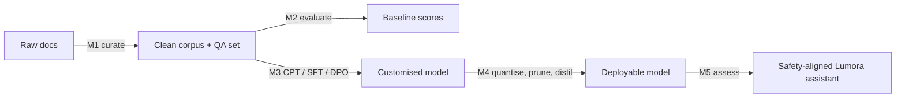

# Adding Knowledge to LLMs

A self-paced, hands-on workshop: take a general-purpose LLM and teach it the products, policies and
style of a company it has never heard of, then make it small and fast enough to deploy.

Every lab runs in **Google Colab**: no install and no GPU of your own. The **free T4 GPU** covers the
core path. **Colab Pro** unlocks bonus exercises with bigger models and NVIDIA tooling.

## Your progress

Progress is saved in this browser only.

## The scenario: Lumora Energy

All five modules use one running case study: **Lumora Energy**, a *fictional* European maker of home
batteries (the Vault 10 and Vault 15), the Bridge inverter and the Lumora Home app. No base model
knows Lumora's warranty terms or error codes, so you can measure exactly how much knowledge each
technique adds.

## Modules

| # | Module | You will | Free track | Pro bonus |
|---|---|---|---|---|
| 1 | [Data curation & synthetic data](modules/01-data-curation.md) | Clean, filter, dedup, redact PII, generate grounded QA | Qwen2.5-1.5B on T4 | 7B generator + LLM judge |
| 2 | [Evaluating LLMs](modules/02-evaluation.md) | MMLU, calibrated LLM-as-a-judge, Elo, MLflow tracking | 0.5B vs 1.5B, 1.5B judge | 1.5B vs 7B, 7B judge, lm-eval-harness |
| 3 | [Customising LLMs](modules/03-customization.md) | CPT for knowledge, SFT for skills, DPO for style | 0.5B: full-FT CPT, LoRA SFT/DPO | 1.5B student, 7B judge |
| 4 | [Optimising for deployment](modules/04-optimization.md) | Quantise, depth-prune, distil | 0.5B: INT8/FP8/INT4, prune 25% of layers, distil | 1.5B student, real-FP8 pointers |
| 5 | [Assessment](modules/05-assessment.md) | Align the assistant to Lumora's safety protocol with DPO, without over-refusing | Qwen2.5-1.5B | Qwen2.5-7B |

## How each module works

1. **Read** the concept page (35-40 min): the ideas, the maths behind them, worked examples and common pitfalls.
2. **Launch the lab** with the *Open in Colab* button.
3. **Complete the exercises.** Each one ends with an auto-check cell; run it until every line says `PASS`.
4. **Take the quiz** at the bottom of the module page.

!!! tip "New here?"
    Start with [Getting started](getting-started.md). It takes 5 minutes and saves headaches later.
