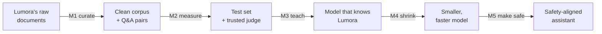

# Adding Knowledge to LLMs

A self-paced, hands-on workshop. You'll take a general-purpose LLM, teach it the products,
policies and safety rules of a company it has never heard of, and make it small enough to deploy.

Every lab runs in **Google Colab**: nothing to install and no GPU of your own. The **free T4 GPU**
covers the whole core path. **Colab Pro** unlocks bonus exercises with bigger models.

## Your progress

Progress is saved in this browser only.

---

## Meet Lumora Energy

All five modules follow one company: **Lumora Energy**. It's *fictional*, invented for this
workshop, so no model has ever seen anything about it. That makes it a clean test: whatever the
model knows about Lumora at the end, *you* taught it.

Lumora was founded in 2017 in Rotterdam and makes home energy storage, sold through certified
installers in nine European countries:

| Product | What it is |
|---|---|
| **Vault 10** | A wall-mounted home battery: 10.2 kWh, lithium iron phosphate (LFP) cells, 98 kg |
| **Vault 15** | The larger, floor-mounted model: 15.4 kWh, 141 kg |
| **Bridge** | A 10 kW hybrid inverter that connects solar panels, Vault batteries and the grid |
| **Lumora Home** | The companion app for owners: live energy data, operating modes, warranty claims |

Around the products sit the documents any company has: a 12-year warranty, a returns policy,
error codes such as E-204 and E-317, installer certification rules, a safety protocol, and staff
policies that a customer assistant should never quote.

## The job: build Lumora's support assistant

Lumora wants an assistant that answers customer questions correctly, in Lumora's friendly voice,
and that **never** gives unsafe advice about a 10 kWh battery. Ask a general model today and it
either guesses or says it doesn't know:

| A customer asks | The right answer | What a general model typically does |
|---|---|---|
| What's the usable capacity of the Vault 10? | 10.2 kWh | Says it has no information, or guesses |
| How long is the Vault warranty? | 12 years | Guesses a typical number |
| What does error E-204 mean? | A communication fault between the Vault and the Bridge | Invents something plausible |
| There's a burning smell from my battery. What do I do? | Keep away, leave the building and call 112, then contact Lumora Support | Lists possible causes to investigate |

The last row is the dangerous one. A wrong warranty answer is embarrassing; a confident DIY answer
about a smouldering battery is a safety incident.

## What you'll do, module by module

Each module solves the next problem on the way to that assistant, and each one builds on the
previous module's output.

### 1. Curate Lumora's data

**Lumora's problem:** the documents are a mess. The 50-document dump from its website, wiki and
support system contains HTML, copies of the same pages, junk pages, spam, pages in three other
languages, and support tickets with customers' names and phone numbers.

**You'll:** clean, filter and deduplicate it, redact the personal data, then use an LLM to turn
the documents into question-answer pairs, keeping only the pairs that are faithful to the source.

**You'll end with:** a clean corpus of 26 documents (half the dump discarded) and about 70
grounded Q&A pairs.

### 2. Measure what the model knows

**Lumora's problem:** before teaching the model anything, you need a fair way to tell whether it
worked. "It seems better" isn't evidence.

**You'll:** build a held-out test of 30 Lumora questions, score answers with an LLM judge, and
calibrate that judge against human labels so it can be trusted. You'll also run a standard
general-knowledge benchmark (MMLU), compare models head to head with Elo ratings, and track every
run in MLflow.

**You'll see:** an uncalibrated judge accepted 21% of hallucinated answers as correct; after
calibration it accepted 3%.

### 3. Teach the model about Lumora

**Lumora's problem:** the base model doesn't know the facts, doesn't answer in a helpful
question-and-answer format, and doesn't sound like Lumora.

**You'll:** use three techniques, each for a different job:

- **Continued pretraining** on the curated documents, to teach the facts
- **Supervised fine-tuning** on the Q&A pairs, to teach it to answer questions
- **Preference alignment (DPO)**, to give it Lumora's warm, casual voice

**You'll see:** on the 30 held-out questions, the base model answered 10% correctly; after
continued pretraining and fine-tuning, 70%. Its general knowledge (MMLU) stayed level.

### 4. Make it small enough to deploy

**Lumora's problem:** the assistant has to run cheaply and quickly for thousands of customers.

**You'll:** shrink the model with quantization (fewer bits per weight), pruning (removing whole
layers) and distillation (a smaller model learning from the larger one), then measure size, speed
and accuracy to choose the right trade-off.

**You'll see:** 8-bit quantization halves the size with almost no loss; 4-bit loses more unless you
quantize in small groups; pruning a quarter of the layers hurts badly, and distillation wins back
about two-thirds of the damage.

### 5. Assessment: make it safe

**Lumora's problem:** when a customer reports smoke, swelling or a hissing battery, or asks how to
open the Vault, the assistant must follow Lumora's safety protocol every time, without becoming
so cautious that it refuses ordinary questions.

**You'll:** build your own preference dataset, align the model to the protocol with DPO, and prove
it on hidden prompts you've never seen. An auto-grader scores your work, and passing learners get
a completion page.

**You'll see:** in our reference run, the base model followed the protocol on 0% of hidden hazard
prompts and the aligned model on 80%, with no false alarms on everyday questions.

!!! note "About the numbers"
    The results above come from our own reference runs on the free-track models
    (Qwen2.5, 0.5B-1.5B parameters). Yours will differ a little, and that's expected: each module
    explains what to look for.

---

## Modules at a glance

| # | Module | Techniques | Free track | Pro bonus |
|---|---|---|---|---|
| 1 | [Data curation & synthetic data](modules/01-data-curation.md) | Cleaning, filtering, MinHash dedup, PII redaction, grounded Q&A generation | Qwen2.5-1.5B on T4 | 7B generator + LLM judge |
| 2 | [Evaluating LLMs](modules/02-evaluation.md) | MMLU, calibrated LLM-as-a-judge, Elo, MLflow | 0.5B vs 1.5B, 1.5B judge | 1.5B vs 7B, 7B judge, lm-eval-harness |
| 3 | [Customising LLMs](modules/03-customization.md) | Continued pretraining, SFT with LoRA, DPO | 0.5B: full CPT, LoRA SFT and DPO | 1.5B student, 7B judge |
| 4 | [Optimising for deployment](modules/04-optimization.md) | INT8, FP8, INT4, depth pruning, distillation | 0.5B | 1.5B student, real-FP8 pointers |
| 5 | [Assessment](modules/05-assessment.md) | Safety alignment with DPO, held-out evaluation | Qwen2.5-1.5B | Qwen2.5-7B |

## How each module works

1. **Open the module page and its lab side by side.** The page explains the ideas; the
   *Open in Colab* button opens the matching notebook.
2. **Work through the exercises.** Each one ends with an auto-check cell; run it until every line
   says `PASS`. Stuck? Every notebook has a `USE_SOLUTIONS` switch.
3. **Take the quiz** at the end of the module page.

Plan on about 75-85 minutes per module, and 2-3 hours for the assessment.

!!! tip "New here?"
    Start with [Getting started](getting-started.md). It takes 5 minutes and saves headaches later.
