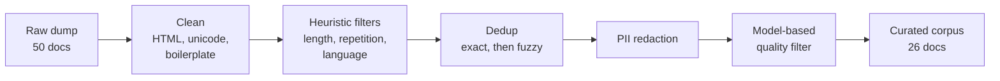

# Module 1: Data curation & synthetic data generation

**Time:** about 35 min reading + 40 min lab &nbsp;|&nbsp; **Track:** Free (T4), with a Pro bonus

## Learning objectives

By the end of this module you should be able to:

- [ ] Explain why data quality, not just quantity, determines what a fine-tuned model learns
- [ ] Design a curation pipeline as a funnel: cheap steps first, expensive steps last
- [ ] Clean scraped text and apply heuristic and model-based quality filters
- [ ] Explain how MinHash and LSH find near-duplicates, and tune the similarity threshold
- [ ] Redact personal data without destroying the knowledge you need
- [ ] Generate synthetic training data and verify it is faithful to its source

---

## 1. Why curation comes first

Everything later in this workshop (continued pretraining, fine-tuning, preference alignment) does
one thing: it makes the model **more likely to produce text that looks like its training data**.
The model has no way of knowing which parts of that data you *meant* it to learn. It absorbs all
of it:

| What's in the data | What the model learns |
|---|---|
| The same page 50 times | To recite that page verbatim (memorisation), wasting capacity |
| Cookie banners and nav menus | To say "Accept all cookies?" in the middle of an answer |
| Customer emails and phone numbers | To reproduce them when prompted: a privacy and legal incident |
| Contradicting versions of a policy | Uncertainty, or the wrong version |
| Pages in other languages | Random language switching |

The research evidence is consistent:

- **Deduplication improves models.** Lee et al. (2022) found that deduplicating training data
  reduced verbatim memorisation roughly tenfold and let models reach the same quality with fewer
  training steps.
- **Filtered data beats more data.** Hugging Face's FineWeb project (2024) showed that heavily
  filtered web data trains better models than larger unfiltered sets, and that the *educational
  quality* subset (FineWeb-Edu) gave large gains on knowledge benchmarks.
- **Memorised data can be extracted.** Carlini et al. (2021) extracted names, phone numbers and
  email addresses verbatim from GPT-2. PII that goes in can come out.

In an enterprise setting the stakes are higher: your data includes customer records, internal
drafts and outdated policies. **Curation is where you decide what the model should know.**

---

## 2. The curation funnel

A good pipeline is a **funnel**: cheap, fast steps remove most of the junk, so expensive steps only
process what's left.

| Stage | Cost per document | Typical tooling | In this lab |
|---|---|---|---|
| Cleaning / extraction | Microseconds | regex, `trafilatura`, `ftfy` | `clean_text` |
| Heuristic filters | Microseconds | Rule sets (Gopher, C4) | word count, repetition, `langdetect` |
| Exact dedup | Microseconds | Hashing | MD5 |
| Fuzzy dedup | Milliseconds | MinHash + LSH | `datasketch` |
| PII redaction | Milliseconds (NER model) | Presidio | Presidio + spaCy |
| Model-based filtering | 10-1000 ms (GPU) | Quality classifiers, LLM judges | LLM judge (Pro bonus) |

Running the LLM judge on raw data would cost hundreds of times more and mostly score junk.
**Order matters.**

---

## 3. Cleaning: get the text out

Scraped pages are mostly *not* content. A typical product page is mostly HTML tags, scripts,
navigation, cookie notices and footers around a few paragraphs of real text. Cleaning steps:

1. **Remove `
