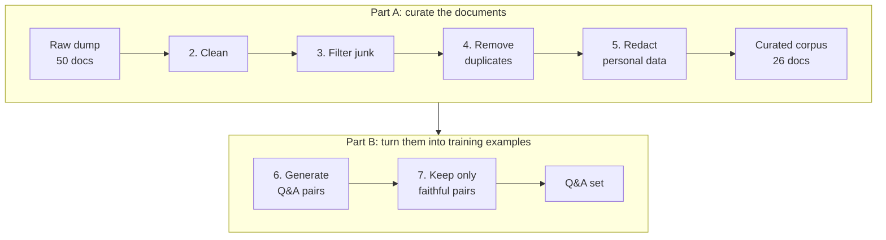

# Module 1: Data curation & synthetic data generation

**Time:** about 75 minutes, reading and lab together &nbsp;|&nbsp; **Track:** Free (T4), with a Pro bonus

## The situation

Lumora Energy, the home-battery company in this workshop's case study, wants an assistant that
answers questions about its products: the Vault batteries, the Bridge inverter and the Lumora Home
app. A general model knows nothing about them. Later modules teach it, but every one of those
methods learns from **data**, so this module builds that data.

Lumora has handed you a dump of **50 documents** pulled from its website, internal wiki and support
system. As in any real company, it's a mess:

| What's in the dump | How many |
|---|---|
| Useful product, policy and support documents | 20 |
| Exact copies of some of those documents | 5 |
| Lightly edited copies (a footer added, a line changed) | 5 |
| Raw HTML copies of web pages, with scripts and menus | 5 |
| Junk: a 404 page, a login prompt, a cookie banner, a blank page | 4 |
| Keyword spam | 2 |
| Pages in German, Spanish and Dutch | 3 |
| Support tickets containing customer names, emails and phone numbers | 6 |

By the end of the module you'll have turned it into the two kinds of data that Module 3 trains on:

1. **A curated corpus**: clean, unique documents with no personal data. Module 3 uses it for
   *continued pretraining*, which teaches the model Lumora's facts.
2. **A set of question-answer pairs** generated from those documents. Module 3 uses it for
   *supervised fine-tuning*, which teaches the model to answer questions.

Module 3 ships a larger version of both, built with this same pipeline, so it works even if you
skip ahead; you can swap in your own files from this lab.

### Why this matters

Every training method in this workshop does the same thing: it makes the model **more likely to
produce text that looks like its training data**. The model can't tell which parts you *meant* it
to learn. Leave the dump as it is and here's what it learns:

| Left in the data | What the model learns |
|---|---|
| The same page five times | To recite that page word for word, at the expense of everything else |
| Cookie banners and menus | To say "Accept all cookies?" in the middle of an answer |
| Customer emails and phone numbers | To repeat them when prompted: a privacy incident |
| German and Dutch pages | To switch language at random |

Research backs this up. Deduplicating training data cut word-for-word memorisation roughly tenfold
(Lee et al., 2022). Heavily filtered web data trains better models than larger unfiltered data
(Hugging Face's FineWeb, 2024). And personal data that goes into a model can be pulled back out:
researchers extracted names, phone numbers and emails from GPT-2 (Carlini et al., 2021).
**Curation is where you decide what the model knows.**

### The plan: a funnel

A good pipeline is a **funnel**. Cheap, fast steps remove most of the junk first, so slower steps
only handle what's left. This module follows the funnel from top to bottom:

**Part A** (steps 1-5) curates the documents; Step 1 is looking at the raw data. **Part B**
(steps 6-7) turns the curated documents into training examples.

**Open the lab now and work through it alongside this page**

The notebook uses the same step numbers as this page. Each step below ends with a
**▶ Lab** box that tells you which exercise to do. Every exercise has an automatic check.

| Exercise | Step | The check confirms |
|---|---|---|
| 1. `clean_text` | 2 | 6 unit tests pass |
| 2. Quality filters | 3 | junk, spam and foreign pages removed; all good documents kept |
| 3. Deduplication | 4 | exactly 20 unique knowledge documents remain |
| 4. PII redaction | 5 | no emails, phones or names left; error codes kept |
| 5. Synthetic Q&A | 6-7 | at least 20 pairs, all grounded in their source |
| Pro bonus | 7 | LLM-as-a-judge filtering (Colab Pro only) |

---

## Part A: Curate the documents

### Step 1: Look at the raw data

Before writing a single rule, **look at the data**. Every rule in a real pipeline should trace
back to a problem someone *saw*. Rules written without looking remove good data and miss bad data.

!!! example "▶ Lab: Step 1"
    Run the setup cells, then scroll through the raw table. Try to spot each problem from the
    table above: the HTML, the copies, the junk pages, the foreign languages and the customer
    details. Which would hurt the model most if left in?

The first thing you'll notice is that many documents are mostly *not* text: they're HTML. That's
the first job.

---

### Step 2: Clean the text

A scraped product page is mostly tags, scripts, menus, cookie notices and footers wrapped around
a few paragraphs of real content. Cleaning extracts the content:

1. **Remove `

### Glossary

| Term | Meaning |
|---|---|
| **Boilerplate** | Repeated non-content text: menus, footers, cookie notices |
| [**NFKC**](https://en.wikipedia.org/wiki/Unicode_equivalence) | A unicode normalisation form that maps equivalent characters to one standard form |
| [**Shingle**](https://en.wikipedia.org/wiki/W-shingling) | A run of k consecutive words, used to represent a document as a set |
| [**Jaccard similarity**](https://en.wikipedia.org/wiki/Jaccard_index) | Shared items divided by all distinct items across two sets |
| [**MinHash**](https://en.wikipedia.org/wiki/MinHash) | A compact signature whose match rate estimates Jaccard similarity |
| [**LSH**](https://en.wikipedia.org/wiki/Locality-sensitive_hashing) | A bucketing scheme that finds likely-similar pairs without comparing every pair |
| [**PII**](https://en.wikipedia.org/wiki/Personal_data) | Personally identifiable information |
| [**NER**](https://en.wikipedia.org/wiki/Named-entity_recognition) | Named-entity recognition: a model that tags names, places and organisations |
| **Grounding** | Whether a generated answer is supported by its source document |
| [**Model collapse**](https://en.wikipedia.org/wiki/Model_collapse) | Quality loss from repeatedly training on model-generated data |

### Further reading

**Papers**

- Lee et al. (2022), [*Deduplicating Training Data Makes Language Models Better*](https://arxiv.org/abs/2107.06499)
- Penedo et al. (2024), [*The FineWeb Datasets: Decanting the Web for the Finest Text Data at Scale*](https://arxiv.org/abs/2406.17557)
- Rae et al. (2021), [*Scaling Language Models: Methods, Analysis & Insights from Training Gopher*](https://arxiv.org/abs/2112.11446) (Appendix: quality filters)
- Broder (1997), [*On the Resemblance and Containment of Documents*](https://doi.org/10.1109/SEQUEN.1997.666900) (MinHash)
- Carlini et al. (2021), [*Extracting Training Data from Large Language Models*](https://arxiv.org/abs/2012.07805)
- Wang et al. (2023), [*Self-Instruct: Aligning Language Models with Self-Generated Instructions*](https://arxiv.org/abs/2212.10560)
- Shumailov et al. (2024), [*AI models collapse when trained on recursively generated data*](https://doi.org/10.1038/s41586-024-07566-y)

**Concepts and tools**

- [Jaccard index (Wikipedia)](https://en.wikipedia.org/wiki/Jaccard_index)
- [w-shingling (Wikipedia)](https://en.wikipedia.org/wiki/W-shingling)
- [MinHash (Wikipedia)](https://en.wikipedia.org/wiki/MinHash)
- [Locality-sensitive hashing (Wikipedia)](https://en.wikipedia.org/wiki/Locality-sensitive_hashing)
- [Leskovec, Rajaraman & Ullman, *Mining of Massive Datasets*, chapter 3: Finding Similar Items (free book; the clearest explanation of shingling, MinHash and LSH)](http://www.mmds.org/)
- [Unicode equivalence and normalisation forms, including NFKC (Wikipedia)](https://en.wikipedia.org/wiki/Unicode_equivalence)
- [Language identification (Wikipedia)](https://en.wikipedia.org/wiki/Language_identification)
- [Named-entity recognition (Wikipedia)](https://en.wikipedia.org/wiki/Named-entity_recognition)
- [Personal data and GDPR (Wikipedia)](https://en.wikipedia.org/wiki/Personal_data)
- [Model collapse (Wikipedia)](https://en.wikipedia.org/wiki/Model_collapse)
- [datasketch: MinHash LSH documentation](https://ekzhu.com/datasketch/lsh.html)
- [Microsoft Presidio documentation](https://microsoft.github.io/presidio/)
- [langdetect (PyPI)](https://pypi.org/project/langdetect/)
- [trafilatura: web text extraction](https://trafilatura.readthedocs.io/)
