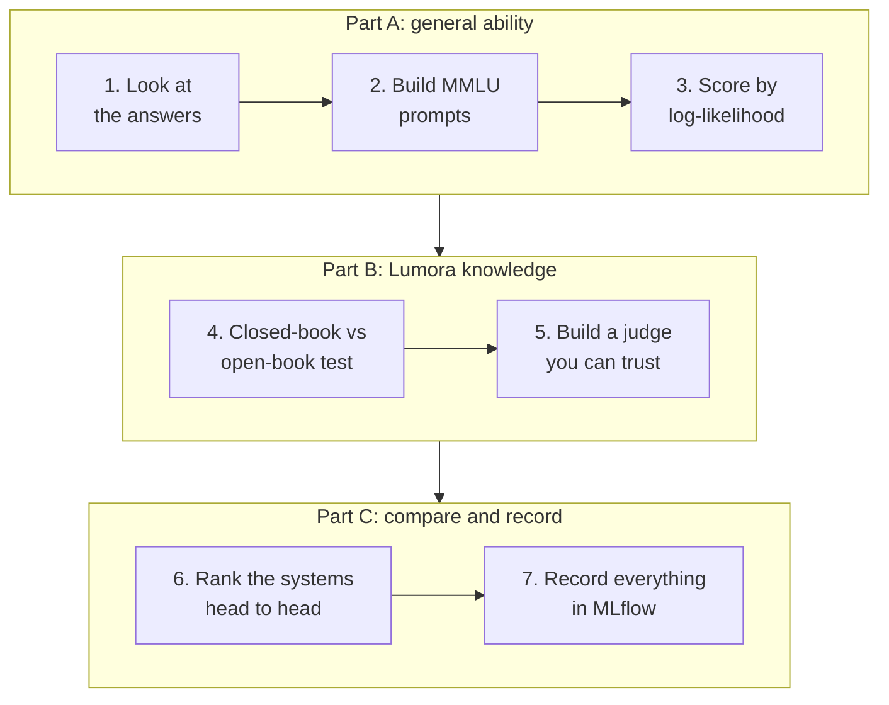

# Module 2: Evaluating LLMs

**Time:** about 85 minutes, reading and lab together &nbsp;|&nbsp; **Track:** Free (T4), with a Pro bonus

## The situation

In Module 1 you built Lumora's training data. Before anyone spends GPU budget training a model on
it (Module 3), Lumora's leadership asks two questions:

1. **How good are the candidate models in general?**
2. **How much do they already know about *our* products?**

They want numbers they can trust, and a record of every experiment so that Module 3's trained
models can be compared against exactly the same baseline.

The candidates are two open models of different sizes: on the free track, **Qwen2.5-0.5B** and
**Qwen2.5-1.5B** (on Pro, 1.5B and 7B). By the end of this module you'll have:

- their general-knowledge scores on a standard benchmark (MMLU)
- their scores on 30 held-out Lumora questions, graded by a judge you've proved you can trust
- a head-to-head ranking of the systems
- every result logged, ready for Module 3 to compare against

### Why this is harder than it sounds

A spam filter outputs "spam" or "not spam", and you compare against labels. An LLM outputs **free
text**, and that breaks the simple recipe:

| Challenge | Lumora example |
|---|---|
| **Many correct answers** | "12 years", "twelve years" and "The warranty lasts 12 years" are all right |
| **Many dimensions** | Correct? Faithful to the source? Helpful? Safe? In Lumora's tone? |
| **Fluent wrong answers** | "The Vault 10 has 13.5 kWh" reads exactly like a correct answer |
| **Prompt sensitivity** | Changing the prompt format can move benchmark scores by several points |
| **Contamination** | Public benchmark questions leak onto the web and into training data |
| **Goodhart's law** | "When a measure becomes a target, it ceases to be a good measure" |

No single number captures quality. Good evaluation **combines methods**, each answering one
question, and is honest about each method's error:

| Method | Question it answers | Cost | Main weakness |
|---|---|---|---|
| **Eyeballing** | Does it work at all? | Your time | Doesn't scale; fluent errors fool you |
| **Benchmarks** (MMLU...) | How capable is the model in general? | Low | Not *your* domain; contamination |
| **Reference metrics** (exact match, F1) | Does the answer match a known answer? | Very low | Punish paraphrase, reward word overlap |
| **LLM-as-a-judge** | Is this free-text answer correct? | Medium | Leniency, position and length biases |
| **Pairwise + Elo** | Which system is better overall? | Medium | Order effects; needs many comparisons |
| **Human evaluation** | Ground truth for all of the above | High | Slow, expensive; raters disagree too |

### The plan

This module climbs that ladder, in three parts:



<div class="lab-card" markdown>
**Open the lab now and work through it alongside this page**

[](https://colab.research.google.com/github/vinothss/add_llmknowledge/blob/main/notebooks/02_evaluation.ipynb)

The notebook uses the same step numbers as this page. Each step ends with a **▶ Lab** box.

| Exercise | Step | The check confirms |
|---|---|---|
| 1. Build MMLU prompts | 2 | 0-shot and 5-shot structure, no leaked answers |
| 2. Log-likelihood scoring | 3 | matches reference scoring on at least 95% of prompts |
| 3. Calibrate the judge | 5 | held-out agreement at least 80%, at most 10% of hallucinations accepted |
| 4. Elo | 6 | 5 unit tests (expected score, update, zero-sum) |
| 5. MLflow tracking | 7 | all MMLU and Lumora runs logged with parameters and metrics |
| Pro bonus | 7 | cross-check with `lm-evaluation-harness` |
</div>

---

## Part A: How capable are the models in general?

### Step 1: Look at the answers

Start by *reading* what the model says. Ask the small model a few Lumora questions with no
documents in the prompt (**closed-book**) and read its answers.

It answers fluently and confidently, and it has never seen a word about Lumora. That's
**hallucination**, and it's why reading answers isn't enough: a confident wrong answer looks just
like a right one, and nobody can read 10,000 of them. You need measurements.

!!! example "▶ Lab: Step 1"
    Run the setup cells and the eyeballing cell. How many of the answers would you have believed?

The first measurement is the broadest: how capable is each model in general?

---

### Step 2: Use a standard benchmark (MMLU)

#### What MMLU is

**MMLU** (Massive Multitask Language Understanding, Hendrycks et al., 2021) has about 14,000
four-option multiple-choice questions across **57 subjects**, from elementary maths and astronomy
to law and medicine. Random guessing scores 25%. For years it was the headline number for general
knowledge and reasoning. Know its limits when you read model cards:

- **Saturation:** frontier models score near the top, so differences stop meaning much. Harder
  successors such as MMLU-Pro exist for this reason.
- **Label errors:** a small percentage of questions have wrong or ambiguous answers.
- **Contamination:** the questions have been public since 2020 and appear in web crawls.
- **Not your domain:** a high MMLU score says nothing about Lumora's warranty.

So in this workshop, MMLU has one specific job: **detecting damage**. If training on Lumora data
in Module 3 hurts the model's general ability, MMLU drops.

#### Zero-shot vs few-shot

**Zero-shot** gives the model the question alone. **Few-shot** shows *k* solved examples first,
typically 5. Brown et al. (2020, the GPT-3 paper) showed that models improve markedly from a few
examples in the prompt **without any training**. This is *in-context learning*. The examples show
the format ("answer with a single letter") and prime the task. Small models usually gain the most.

!!! example "▶ Lab: Exercise 1, build MMLU prompts"
    Write `build_prompt` for zero-shot and 5-shot. The check confirms the structure and that no
    answer leaks into the prompt.

Now you have prompts. The next question is how to read the model's answer reliably.

---

### Step 3: Score by log-likelihood

You could let the model write an answer and pick out "The answer is B" with a pattern, but models
write "B)", "(B)", "Option B", or explain first and answer last. Parsing is fragile, and random
sampling adds noise.

Evaluation harnesses instead end the prompt with `Answer:` and look at the probability the model
gives to each possible **next token**:

```
...
C. It would be harder since the truck is lighter on Mars.
D. It would be the same no matter where you are.
Answer:      ->  P(" A") = 0.08   P(" B") = 0.71   P(" C") = 0.05   P(" D") = 0.16   -> predict B
```

One forward pass per question, no parsing, and the same answer every run.

??? info "Why the leading space in ' A'?"
    Tokenizers usually treat a word and the same word with a space in front as **different
    tokens**. After "Answer:" the natural continuation is " B", with a space. The probability of
    "B" without the space measures something the model rarely writes. Details like this are why
    different harnesses report slightly different numbers for the same model.

!!! example "▶ Lab: Exercise 2, write `predict_letters`"
    Score each prompt by comparing the next-token probabilities of `" A"` to `" D"`. Then run MMLU
    zero-shot and 5-shot for both models and compare.

General ability is measured. But MMLU can't tell you the thing Lumora cares about most.

---

## Part B: How much do they know about Lumora?

### Step 4: Test Lumora knowledge, closed-book and open-book

Public benchmarks can't tell you whether a model knows *your* domain. For that you need your own
test set. The lab ships one: **30 human-written Lumora questions** with reference answers, covering
products, warranty, error codes, policies and engineering notes.

!!! warning "Rules for a trustworthy domain test"
    1. **Held out:** never used for training, prompt examples or tuning.
    2. **Written independently** of the training data, ideally by different people.
    3. **Covers the categories you care about**, with enough questions in each.
    4. **Clear reference answers.** Avoid yes/no questions: a model guesses those right 50% of the time.
    5. **Versioned**, so scores from different months are comparable.

The lab runs three setups:

| Setup | Prompt contains | Measures |
|---|---|---|
| Small model, closed-book | The question | What the model *knows* |
| Large model, closed-book | The question | Whether a bigger model knows more |
| Large model, **open-book** | The question **plus the source document** | Whether the model can *use* the knowledge when it has it |

Expect both closed-book setups to score low and open-book to score near 100%. Two lessons:
**a bigger model doesn't know facts it never saw**, and **the gap between closed-book and open-book
is the size of Lumora's knowledge problem.** Retrieval (RAG) closes it by putting documents in the
prompt at question time; Module 3 closes it by training the knowledge in.

#### A cheap metric first, and why it isn't enough

The cheapest way to grade an answer is to compare it with the reference:

| Metric | How | Fails on |
|---|---|---|
| **Exact match** | The answer equals the reference (after normalising) | Any paraphrase: "twelve years" vs "12 years." |
| **Token F1** | Word overlap ([F-score](https://en.wikipedia.org/wiki/F-score)): the balance of precision and recall | Wrong answers that reuse the question's words |
| **ROUGE / BLEU** | Overlap of word sequences | The same, plus length effects |
| **Embedding similarity** | Cosine similarity of sentence embeddings | "12 years" and "15 years" look almost identical |

!!! example "Token F1 rewarding the wrong answer"
    Reference: *"12 years."*

    - Answer A: *"The Lumora Vault warranty lasts for 12 years."* F1 = 0.40 (correct, but wordy)
    - Answer B: *"The Lumora Vault warranty typically lasts 5 years."* F1 = 0.20 (**wrong**, still gets credit)
    - Answer C: *"Twelve years."* F1 = 0.50 (correct, but "twelve" doesn't match "12")

    The correct answers score only 0.4-0.5, and the wrong one gets half as much credit. Reference
    metrics are fine for short, standard answers such as numbers and names; free-text answers need
    a grader that understands meaning.

!!! example "▶ Lab: Step 4"
    Generate closed-book and open-book answers, compute token F1, and read the answers next to
    their scores. Does F1 reward the right things?

So you need a grader that understands meaning: another LLM. But a grader you haven't tested is
just another source of error.

---

### Step 5: Build a judge you can trust

#### The idea

Use an LLM to grade answers: give it the question, the reference answer and the candidate, and
ask "Is the candidate correct?". Zheng et al. (2023) found that a strong judge such as GPT-4 agreed
with human preferences about 80% of the time, roughly as often as two humans agree. That made LLM
judging the standard way to grade open-ended output at scale.

| Setup | Judge sees | Use when |
|---|---|---|
| **Reference-guided grading** | Question + reference + candidate | You have a correct answer (the Lumora test) |
| **Single-answer scoring** | Question + candidate, with a rubric | No reference, e.g. helpfulness |
| **Pairwise comparison** | Question + two candidates | Ranking systems (Step 6) |

Judges have well-known biases:

| Bias | What happens | Fix |
|---|---|---|
| **Leniency** | Says "correct" to fluent nonsense, especially small judges | Calibrate on human labels (below) |
| **Position bias** | Prefers whichever answer is shown first, or second | Judge both orders and average |
| **Length bias** | Prefers longer answers | Rubrics that reward concision |
| **Self-preference** | Rates its own model family higher | Use a different, stronger judge |

#### A judge is a classifier, so test it like one

When the judge says "correct" or "incorrect", it's a classifier, and human labels are the ground
truth:

| | Human: correct | Human: incorrect |
|---|---|---|
| **Judge: correct** | True positive | **False positive: hallucination accepted** |
| **Judge: incorrect** | False negative: correct answer rejected | True negative |

Two numbers matter most: **agreement** (how often the judge matches the human) and the
**false-positive rate** (the share of wrong answers the judge accepts). The second is the dangerous
one, because it **inflates your model's score** and hides the hallucinations you're trying to
measure.

#### A real example from building this lab

1. **Hand-written test cases looked fine.** On 30 invented answers, a 1.5B judge agreed with the
   human labels about 90% of the time.
2. **Real model answers told a different story.** On actual closed-book answers from the candidate
   models, the same judge accepted about **half** as correct, when a careful human reading found
   only about 10% were. Real hallucinations are fluent, specific and plausible ("The warranty
   typically lasts 5 years"). Invented test cases rarely look like that.
3. **The lesson: test the judge on the kind of answers it will actually grade.** The lab's
   calibration set has 155 items, 120 of them real answers from the candidate models, each labelled
   by a person.

#### Calibrate with the judge's confidence

Instead of trusting the judge's Yes or No, read how *confident* it is from the probability of its
first token:

$$\text{score} = \log P(\text{"Yes"}) - \log P(\text{"No"})$$

A positive score means it leans Yes. Then **choose the threshold from the human labels**: try every
candidate threshold on the calibration questions and keep the one with the best agreement. On
ties, choose the stricter threshold, because accepting hallucinations is the costlier mistake.

**Never tune and report on the same data.** The lab tunes on questions q01-q15 and reports on
q16-q30, so no question's answers appear on both sides:

| Judge | Agreement (tuning set) | **Agreement (test set)** | **Hallucinations accepted (test set)** |
|---|---|---|---|
| Naive (threshold 0: trust its Yes/No) | 88% | 86% | **21%** |
| Calibrated (threshold about 4.0) | 95% | **84%** | **3%** |

Agreement barely changes, but **accepted hallucinations drop from about 1 in 5 to about 1 in 30**,
and that's what protects your scores. The calibrated judge also does better on the tuning set than
on the test set: the threshold slightly **overfits** the data it was tuned on, which is why you
report the test number.

??? info "Beyond accuracy: Cohen's kappa"
    If 90% of answers are wrong, a judge that always says "incorrect" scores 90% agreement while
    learning nothing. **[Cohen's kappa](https://en.wikipedia.org/wiki/Cohen%27s_kappa)** corrects
    for chance agreement: $\kappa = \frac{p_o - p_e}{1 - p_e}$, where $p_o$ is the observed
    agreement and $p_e$ the agreement expected by chance. Values above about 0.6 are usually read as
    substantial agreement. The lab's calibration set is roughly balanced, so accuracy is meaningful
    there; use kappa when your classes are skewed.

!!! example "▶ Lab: Exercise 3, calibrate the judge"
    Write `pick_threshold`, compare the naive and calibrated judges on the test questions, then
    grade all three systems with your calibrated judge.

You can now score answers against a reference. But some questions don't have one.

---

## Part C: Compare and record

### Step 6: Rank the systems head to head

#### Why compare in pairs?

For style, helpfulness or chat quality there's no single right answer, and absolute scores drift
("is this a 7 or an 8?"). People and LLM judges are more consistent at **relative** judgements:
"Is A or B better?". Chatbot Arena ranks models this way from millions of votes.

#### The Elo system

Each system has a rating $R$ (see [Elo rating system](https://en.wikipedia.org/wiki/Elo_rating_system)).
Before a comparison, the **expected score** of A against B is:

$$E_A = \frac{1}{1 + 10^{(R_B - R_A)/400}}$$

After it, with actual score $S_A$ (1 for a win, 0.5 for a tie, 0 for a loss, or any probability in
between):

$$R_A' = R_A + K\,(S_A - E_A), \qquad R_B' = R_B - K\,(S_A - E_A)$$

| Rating gap | Expected win rate of the higher-rated system |
|---|---|
| 0 | 50% |
| 100 | 64% |
| 200 | 76% |
| 400 | 91% |

$K$ (the lab uses 32) sets how far one comparison moves the ratings. What A gains, B loses. An
upset moves ratings a lot; an expected result barely moves them.

#### Practical details

- **Order:** Elo processes comparisons one at a time, so the order changes the final ratings. The
  lab averages over 50 random orders. Chatbot Arena switched to the
  **[Bradley-Terry](https://en.wikipedia.org/wiki/Bradley%E2%80%93Terry_model)** model, which fits
  all results at once.
- **Position bias:** the lab judges every pair twice, with the answers swapped, and averages. The
  notebook prints the measured bias; small judges often lean clearly towards one position.
- **Uncertainty:** ratings from a few dozen comparisons are noisy. Report confidence intervals
  (bootstrap: resample the comparisons, recompute, repeat) when systems are close.

!!! example "▶ Lab: Exercise 4, write `elo_expected` and `elo_update`"
    Pass the unit tests, then run the tournament: every pair of systems on every question, judged
    in both orders.

#### Is the difference real?

Before you announce a winner, check that the gap isn't noise. With 30 questions, each one is worth
3.3 percentage points. If a model's true accuracy is 50%, the 95%
[confidence interval](https://en.wikipedia.org/wiki/Binomial_proportion_confidence_interval) on a
30-question test is roughly:

$$\pm 1.96\sqrt{\frac{p(1-p)}{n}} = \pm 1.96\sqrt{\frac{0.5 \times 0.5}{30}} \approx \pm 18 \text{ points}$$

So **"57% vs 50%" on 30 questions is not evidence of a difference.** "10% vs 70%" is.

- Use a few hundred questions before trusting single-digit differences.
- Compare models on the **same** questions and look at which ones changed.
- Generate with temperature 0, as the lab does, or average several runs.
- Count the judge's error rate as part of the noise.

You now have a lot of numbers. The last step makes sure they're still useful next week.

---

### Step 7: Record everything in MLflow

Three weeks from now, nobody will remember which prompt, model version or judge threshold
produced "72%". Module 3 needs to compare its trained models against *exactly* these baselines.
MLflow organises results as:

| Concept | Meaning | Lab example |
|---|---|---|
| **Experiment** | A group of related runs | `lumora-eval` |
| **Run** | One evaluation of one configuration | `mmlu-Qwen2.5-1.5B-Instruct-5shot` |
| **Params** | What you did | model, benchmark, k_shot, judge |
| **Metrics** | What happened | mmlu_acc, lumora_acc, token_f1, elo |
| **Tags** | Free-form labels | tier = free / pro |
| **Artifacts** | Files | predictions, plots, the judge prompt |

For full reproducibility, also record the model **revision** (its commit on Hugging Face), the
dataset version, prompt templates, seeds and library versions.

!!! example "▶ Lab: Exercise 5, write `log_run`"
    Log every MMLU and Lumora result with its parameters and metrics, then query them back.

!!! example "▶ Lab: Pro bonus, cross-check with `lm-evaluation-harness` (Colab Pro)"
    Your MMLU numbers come from code you wrote. Production teams use standard harnesses so results
    are comparable across papers. Run the harness and compare its number with yours.

### Module result

The notebook saves `baselines.json` and the MLflow database: general-knowledge scores, Lumora
scores from a judge you've tested, and a ranking. Module 3 trains on Module 1's data and measures
its models against these numbers.

<div class="lab-complete" data-id="m02"></div>

---

## Wrap-up

### Key takeaways

- **Read answers first, then measure.** Fluent doesn't mean correct.
- **Use each method for its own question.** MMLU for general ability (and damage), your own test
  for domain knowledge, a judge for free text, pairwise comparison for overall quality.
- **Test the judge before trusting it,** on real answers, and report its error on held-out data.
- **Small test sets are noisy.** Don't declare a winner on a few points.
- **Record everything,** or you can't compare later.

### At production scale: NVIDIA NeMo Evaluator

| Lab | NeMo Evaluator |
|---|---|
| MMLU loop / `lm-evaluation-harness` | Academic benchmark jobs (MMLU, GSM8K...) submitted via API |
| `k_shot` | `num_fewshot` in the evaluation config |
| Calibrated judge | LLM-as-a-judge evaluation with custom prompts and metrics |
| Lumora test set | Custom dataset evaluation |
| MLflow | Results store and MLflow integration |

### Common pitfalls

- [ ] Trusting fluent answers without measuring
- [ ] Using MMLU, or any public benchmark, as evidence of *domain* knowledge
- [ ] Yes/no questions in your test set (50% by guessing)
- [ ] Trusting an LLM judge without testing it against human labels
- [ ] Testing the judge on invented examples instead of real model answers
- [ ] Tuning and reporting on the same data
- [ ] Judging pairs in one order only (position bias)
- [ ] Declaring a winner from a few points on a small test set
- [ ] Not recording prompts, model versions and thresholds

### Knowledge check

<script type="application/json" class="quiz" data-id="m02">
[
  {"q": "Why do benchmark harnesses score MMLU with next-token log-probabilities instead of generating an answer?",
   "options": ["It is more creative", "One forward pass, no answer parsing, and deterministic results", "Generation is not possible for small models", "It makes the model smarter"],
   "answer": 1, "why": "Comparing P(' A')...P(' D') avoids fragile parsing and sampling noise."},
  {"q": "A 1.5B and a 0.5B model both score near 0% closed-book on Lumora questions but about 100% open-book. What does this tell you?",
   "options": ["The benchmark is broken", "Bigger models always know more", "The models lack the knowledge, not the ability to use it once supplied", "The judge is too strict"],
   "answer": 2, "why": "A bigger model doesn't know facts it never saw. Supplying them, in the prompt or by training, does."},
  {"q": "Calibration barely changed the judge's agreement (86% to 84%) but cut accepted hallucinations from 21% to 3%. Why does the second number matter more?",
   "options": ["It doesn't", "Accepted hallucinations inflate a model's score and hide exactly the errors you're trying to measure", "False negatives are impossible", "Agreement is always 50%"],
   "answer": 1, "why": "A lenient judge makes bad models look good. The false-positive rate is the dangerous error."},
  {"q": "Your judge agrees with humans 95% on the tuning questions and 84% on the test questions. What is going on?",
   "options": ["The test labels are wrong", "The threshold slightly overfits the tuning questions, so report the test number", "The judge got worse while running", "Agreement can't be compared across sets"],
   "answer": 1, "why": "Anything tuned on data looks best on that data. The held-out score is the honest estimate."},
  {"q": "Why is each pairwise comparison judged twice with the answers swapped?",
   "options": ["To double the dataset", "LLM judges tend to prefer one position; averaging both orders cancels that bias", "Elo requires an even number of games", "To check the answers are different"],
   "answer": 1, "why": "Position bias is one of the best-documented LLM-judge biases."},
  {"q": "Two systems have Elo 1100 and 1000. Roughly how often should the first one win a comparison?",
   "options": ["50%", "64%", "91%", "100%"],
   "answer": 1, "why": "E = 1 / (1 + 10^(-100/400)), about 0.64."},
  {"q": "Model A scores 57% and model B 50% on your 30-question test. What can you conclude?",
   "options": ["A is clearly better", "Not much: the 95% confidence interval is about ±18 points at this size", "B is better", "The test is contaminated"],
   "answer": 1, "why": "Small test sets are noisy. You'd need hundreds of questions to trust a 7-point gap."}
]
</script>

### Glossary

| Term | Meaning |
|---|---|
| **Benchmark** | A fixed, public test set for comparing models |
| **Log-likelihood scoring** | Picking the option the model gives the highest probability |
| [**In-context learning**](https://en.wikipedia.org/wiki/Prompt_engineering) | Improving behaviour with examples in the prompt, without training |
| **Closed-book / open-book** | Answering from memory vs with the source document in the prompt |
| **Calibration** | Aligning a judge's decisions with human labels, e.g. by choosing a threshold |
| [**False-positive rate**](https://en.wikipedia.org/wiki/Confusion_matrix) | The share of truly incorrect answers that the judge accepts |
| **Position bias** | A judge preferring an answer because of where it appears |
| [**Elo**](https://en.wikipedia.org/wiki/Elo_rating_system) | A rating system that updates scores from pairwise results |
| [**Confidence interval**](https://en.wikipedia.org/wiki/Binomial_proportion_confidence_interval) | The range likely to contain the true value, given sampling noise |
| **Contamination** | Test items present in training data |

### Further reading

**Papers**

- Hendrycks et al. (2021), [*Measuring Massive Multitask Language Understanding*](https://arxiv.org/abs/2009.03300)
- Brown et al. (2020), [*Language Models are Few-Shot Learners*](https://arxiv.org/abs/2005.14165)
- Zheng et al. (2023), [*Judging LLM-as-a-Judge with MT-Bench and Chatbot Arena*](https://arxiv.org/abs/2306.05685)
- Liang et al. (2022), [*Holistic Evaluation of Language Models (HELM)*](https://arxiv.org/abs/2211.09110)
- Chiang et al. (2024), [*Chatbot Arena: An Open Platform for Evaluating LLMs by Human Preference*](https://arxiv.org/abs/2403.04132)
- EleutherAI, [`lm-evaluation-harness`](https://github.com/EleutherAI/lm-evaluation-harness) (GitHub)

**Concepts and tools**

- [MMLU dataset card (Hugging Face)](https://huggingface.co/datasets/cais/mmlu)
- [F-score / F1 (Wikipedia)](https://en.wikipedia.org/wiki/F-score)
- [Confusion matrix (Wikipedia)](https://en.wikipedia.org/wiki/Confusion_matrix)
- [Cohen's kappa (Wikipedia)](https://en.wikipedia.org/wiki/Cohen%27s_kappa)
- [Binomial proportion confidence interval (Wikipedia)](https://en.wikipedia.org/wiki/Binomial_proportion_confidence_interval)
- [Bootstrapping in statistics (Wikipedia)](https://en.wikipedia.org/wiki/Bootstrapping_(statistics))
- [Elo rating system (Wikipedia)](https://en.wikipedia.org/wiki/Elo_rating_system)
- [Bradley-Terry model (Wikipedia)](https://en.wikipedia.org/wiki/Bradley%E2%80%93Terry_model)
- [Goodhart's law (Wikipedia)](https://en.wikipedia.org/wiki/Goodhart%27s_law)
- [In-context learning and prompt engineering (Wikipedia)](https://en.wikipedia.org/wiki/Prompt_engineering)
- [MLflow Tracking documentation](https://mlflow.org/docs/latest/tracking.html)
