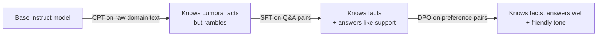

# Module 3: Customising LLMs (CPT, SFT, DPO)

**Time:** about 40 min reading + 45 min lab &nbsp;|&nbsp; **Track:** Free (T4), with a Pro bonus

## Learning objectives

By the end of this module you should be able to:

- [ ] Explain where an LLM's knowledge lives and why prompting alone can't always add it
- [ ] Decide between RAG, CPT, SFT and DPO for a given business goal
- [ ] Describe the training objective of each technique and what it changes inside the model
- [ ] Explain how LoRA works, calculate its size, and say when full fine-tuning is the better choice
- [ ] Prepare data in the correct format for each technique, including loss masking and decontamination
- [ ] Read training logs (loss, perplexity, DPO reward metrics) and spot the common failure modes

---

## 1. Where does a model's knowledge live?

A language model is trained on one task: **predict the next token**. Given "The Eiffel Tower is
in", it assigns a probability to every token in its vocabulary, and training nudges the weights so
"Paris" gets more probability. After trillions of tokens, the weights hold a compressed statistical
memory of the training text. This is called **parametric knowledge**: it's stored in the
parameters, not in a database you can look things up in.

Three consequences shape everything in this module:

1. **The model only knows what was in its training data.** Lumora Energy is fictional, so no
   model has ever seen "the Vault 10 has 10.2 kWh of usable capacity". In Module 2 the base model
   scored about 10% on Lumora questions, and most of that was lucky guessing.
2. **Not knowing doesn't stop the model from answering.** It was trained to produce *plausible
   text*, not to say "I don't know". So it confidently invents a capacity, a warranty term or an
   error-code meaning. That's a **hallucination**.
3. **Changing what the model knows means changing its weights**, or putting the information in
   front of it at question time.

### Two ways to give a model new knowledge

| | In-context (RAG, long prompts) | In the weights (fine-tuning) |
|---|---|---|
| **How** | Retrieve relevant documents and paste them into the prompt | Train the model on the new information |
| **Module 2 result** | Open-book scored about 100% | This module: closed-book rises from about 10% to about 70% |
| **Update a fact** | Edit the document, instantly | Retrain |
| **Cost per question** | Higher: long prompts, plus a retrieval system to run | Lower: short prompts |
| **Good at** | Fast-changing facts, citations, large document sets | Stable domain vocabulary, style, behaviour, response format, latency-critical apps |
| **Weak at** | Behaviour and style; needs retrieval to work well | Fresh facts; risk of forgetting other skills |

!!! tip "In practice teams combine both"
    A common enterprise pattern: **fine-tune** for domain language, tone and answer format, and
    use **RAG** for facts that change. This module focuses on the fine-tuning half. Seeing how far
    closed-book knowledge can be pushed also shows you exactly what RAG buys you.

---

## 2. Three techniques, three goals

Fine-tuning isn't one thing. The three techniques in this module use different data and
different objectives, and they change the model in different ways.



| | Continued pretraining (CPT) | Supervised fine-tuning (SFT) | Direct preference optimisation (DPO) |
|---|---|---|---|
| **Goal** | Knowledge | Skills, task format | Behaviour: style, tone, safety |
| **Data** | Raw domain text (manuals, policies, wikis) | Prompt -> ideal response | Prompt + *chosen* + *rejected* response |
| **How much data** | Thousands of documents up to billions of tokens | Hundreds to tens of thousands of examples | Hundreds to tens of thousands of pairs |
| **Learns from** | Every token | Response tokens only | The *difference* between chosen and rejected |
| **Lab setup** | Full fine-tuning, 6 epochs, LR 3e-5 | LoRA r=16, 6 epochs, LR 2e-4 | LoRA r=16, 3 epochs, LR 5e-5, beta=0.1 |
| **Typical failure** | Forgets general skills | Learns the format, invents the facts | Over-optimisation: fluent but empty |

The usual production order is **CPT -> SFT -> DPO**: first know, then do, then behave.

---

## 3. Continued pretraining (CPT): adding knowledge

### The objective

CPT uses exactly the same objective the model was originally pretrained with. For a document of
tokens $x_1 \dots x_T$, the loss is the average negative log-probability of each token given
everything before it:

$$\mathcal{L}_\text{CPT} = -\frac{1}{T}\sum_{t=1}^{T} \log p_\theta(x_t \mid x_1, \dots, x_{t-1})$$

Every token in the document is a training target. When the model reads "The Vault 10 weighs" and
the next token is "98", the gradient pushes the weights so "98" becomes more likely in that context.
Repeat this across every sentence for several epochs and the facts become part of the model's
parametric memory. The technique is also called *domain-adaptive pretraining* (Gururangan et al.,
2020, showed that continuing pretraining on in-domain text consistently helps downstream tasks).

### Measuring it: perplexity

[Perplexity](https://en.wikipedia.org/wiki/Perplexity) is the exponential of the loss: $\text{PPL} = e^{\mathcal{L}}$. Intuitively it's
*how many tokens the model is choosing between* at each step. A perplexity of 20 means the model
is about as uncertain as if it were picking uniformly among 20 options. The lab measures perplexity
on **held-out Lumora fact sentences** (the eval questions plus their reference answers, which are
never trained on). If CPT worked, those facts become much less surprising and perplexity drops
sharply. The lab's check requires at least a 30% drop.

### Memorising vs knowing: why paraphrases matter

A model that has seen one sentence, "The Vault 10 weighs 98 kg", fifty times can *recite* it, but it
may still fail "How heavy is the Vault 10?" or "What's the weight of Lumora's 10 kWh battery?".
Research on how language models store facts (Allen-Zhu & Li, *Physics of Language Models*, Part 3.1,
2023) found that models reliably **extract** a fact in answer to new questions only when they saw it
in **several phrasings** during training. A single phrasing tends to be stored as a string, not as a
fact.

That's why the shipped CPT corpus contains each of the 20 Lumora documents **plus 2-3 LLM-written
paraphrases** (an FAQ version, a training-note version, a plain paragraph). Each paraphrase was
kept only if every number in the original survived. Even so, a few contain small errors, such as
"after purchase" instead of "after delivery". **Augmented data needs the same QA as original data.**

### Full fine-tuning vs LoRA for CPT

The lab uses **full fine-tuning** for CPT: every one of the model's roughly 494 million parameters is
updated. The reason is empirical. In testing on this lab's data, LoRA-based CPT reached about 27% on
the Lumora benchmark while full CPT reached about 50%. This matches published findings (Biderman et
al., *LoRA Learns Less and Forgets Less*, 2024): on knowledge-heavy continued pretraining, LoRA
substantially underperforms full fine-tuning. It also forgets less, which is the other side of the
same trade-off. Section 5 explains why.

??? info "Memory maths: does full fine-tuning fit on a free T4?"
    Training with the Adam optimiser in fp32 needs about **16 bytes per parameter**:

    | Item | Bytes per parameter | 0.5B model |
    |---|---|---|
    | Weights (fp32) | 4 | 2 GB |
    | Gradients | 4 | 2 GB |
    | Adam first moment (m) | 4 | 2 GB |
    | Adam second moment (v) | 4 | 2 GB |
    | **Total, before activations** | **16** | **about 8 GB** |

    A T4 has 16 GB, so a 0.5B model fits, but activations need room too. Over Qwen's 151,000-token
    vocabulary, the output-layer activations alone are about 1-2 GB per batch of 4. So on GPUs the lab
    uses **8-bit Adam**: the two moment buffers shrink from 8 to 2 bytes per parameter, saving about
    3 GB. A 1.5B model (Pro track) would need about 24 GB at 16 bytes/param, so it also uses
    **gradient checkpointing** (activations are recomputed during the backward pass instead of stored). A 7B model would need about 112 GB for full fine-tuning, which
    is why LoRA exists.

### Catastrophic forgetting

Every gradient step that makes Lumora facts more likely also moves weights that encoded other
things. Push hard on a tiny corpus for many epochs and general ability degrades. This is called
**catastrophic forgetting**. The lab tracks it with a small MMLU slice before and after each stage.
Production recipes limit forgetting by:

- **Mixing in general data** ("replay"), e.g. 10-30% general text alongside the domain corpus
- Using a **lower learning rate** and fewer epochs
- **Monitoring** a general benchmark during training and stopping early if it drops

### CPT data format

One document per row, with the end-of-sequence token appended so the model learns where documents
stop:

```json
{"text": "The Lumora Vault 10 is a wall-mounted home battery with 10.2 kWh of usable capacity. ... <|im_end|>"}
```

!!! warning "CPT pitfalls"
    - **Learning rate too high** for full fine-tuning (e.g. 2e-4, a LoRA rate): the loss spikes and
      general ability collapses. Use about 1e-5 to 5e-5.
    - **Too few epochs on a tiny corpus:** the facts never stick. The lab uses 6 epochs over 68 texts.
    - **Too many epochs:** the training loss goes to about 0 and the model starts reciting documents
      verbatim when asked anything.

---

## 4. Supervised fine-tuning (SFT): teaching a skill

### What SFT is for

After CPT the model *knows* more, but it was trained to continue documents. Ask it a question and
it may continue writing a manual page. SFT shows the model many examples of
**input -> desired output**, so it learns the *behaviour*: here, answering a support question in one
short, accurate sentence.

### The objective, and loss masking

The loss has the same form as CPT, but only the **response tokens** count:

$$\mathcal{L}_\text{SFT} = -\frac{1}{|R|}\sum_{t \in R} \log p_\theta(x_t \mid x_{<t})$$

where $R$ is the set of positions in the assistant's reply. The prompt is still fed through the
model as context, but its tokens are **masked** (their labels are set to -100) so they contribute no
gradient:

| Tokens | `<system>` You are Lumora's support assistant... | `<user>` How long is the Vault warranty? | `<assistant>` 12 years. `<end>` |
|---|---|---|---|
| **In the loss?** | no (masked) | no (masked) | **yes** |

Without masking, a share of the training effort goes into learning to *generate questions and
system prompts*, which is wasted work and can leak into outputs. In TRL you get masking by giving
the data in **prompt/completion** format; the trainer applies the model's chat template and masks
the prompt automatically.

### SFT data format

```json
{
  "prompt": [
    {"role": "system", "content": "You are Lumora Energy's support assistant. Answer in one short sentence."},
    {"role": "user", "content": "What does error code E-317 indicate?"}
  ],
  "completion": [
    {"role": "assistant", "content": "The Bridge has lost its internet connection for more than 72 hours."}
  ]
}
```

??? info "What is a chat template?"
    Instruct models are trained with special tokens that mark who is speaking. Qwen2.5, for
    example, wraps each turn in `<|im_start|>role ... <|im_end|>`. The **chat template** (stored
    with the tokenizer) turns a list of messages into that exact string. Always use the model's own
    template, both in training and at inference. A mismatch is one of the most common reasons a
    fine-tuned model suddenly behaves strangely. Read more: [Hugging Face chat templates guide](https://huggingface.co/docs/transformers/chat_templating).

### Quality beats quantity

The LIMA study (Zhou et al., 2023) fine-tuned a 65B model on just **1,000 carefully curated
examples** and got a strong assistant, evidence that SFT mainly teaches *format and behaviour* the
model can already partly do. The same logic explains a key lab result:

!!! example "Lab result: SFT alone doesn't add knowledge"
    | Model | Lumora accuracy | Why |
    |---|---|---|
    | base | about 10% | No knowledge, rambling format |
    | **SFT only** | **about 20%** | Perfect one-sentence format, **invented facts** |
    | CPT only | about 50% | Knows facts, but answers can ramble or drift |
    | **CPT -> SFT** | **about 70%** | Knowledge **plus** the answer format |

    SFT on about 90 Q&A pairs can't teach 20 documents' worth of facts. It teaches the model *how*
    to answer, and the model fills that shape with whatever it knows. With CPT first, it knows
    the right things.

### Decontamination: don't let your test leak into training

The SFT pairs were generated from the same 20 documents the evaluation questions were written from,
so some generated questions are near-copies of evaluation questions:

| Training question (generated) | Evaluation question (held out) |
|---|---|
| "What is the usable capacity of the Lumora Vault 10?" | "What is the usable capacity of the Lumora Vault 10?" |
| "How many Vault 15 units can be connected to a single Bridge inverter?" | "What is the maximum number of Vault 15 units on a single Bridge inverter?" |

Training on these would inflate the score without teaching anything new. It's like giving students
the exam questions to study. The lab compares **content words** (words left after removing "the",
"what", "is" and so on) and computes their **[Jaccard similarity](https://en.wikipedia.org/wiki/Jaccard_index)** (the same measure Module 1 uses for deduplication):

$$J(A, B) = \frac{|A \cap B|}{|A \cup B|}$$

Any training question with $J \ge 0.6$ against any evaluation question is dropped. With the shipped
data that removes 13 of 101 pairs. Public benchmarks suffer from the same problem at internet scale,
and it's called **benchmark contamination**.

---

## 5. LoRA: fine-tuning with a fraction of the parameters

### The idea

Full fine-tuning updates every weight matrix $W$ (for example 896 x 896 in an attention projection).
Hu et al. (2021) observed that the *change* needed during fine-tuning, $\Delta W$, tends to be
**low-rank**: it can be well approximated by the product of two thin matrices. LoRA freezes $W$ and
learns only those two thin matrices:

$$W' = W + \Delta W = W + \frac{\alpha}{r} B A, \qquad B \in \mathbb{R}^{d \times r},\; A \in \mathbb{R}^{r \times k},\; r \ll \min(d, k)$$

- $r$ (the **rank**) controls capacity. The lab uses 16.
- $\alpha$ is a scaling factor. The lab uses $\alpha = 2r = 32$, a common default.
- $B$ starts at zero, so at step 0 the model is exactly the original.
- After training, $BA$ can be **merged** into $W$ (`merge_and_unload()`), so there's no extra
  inference cost.

### How big is a LoRA adapter?

For a matrix of shape $d \times k$, the adapter adds $r(d + k)$ parameters. For Qwen2.5-0.5B (hidden
size 896, MLP size 4864, 24 layers) with $r = 16$ on all seven projection matrices:

| Matrix | Shape | LoRA params, r(d+k) |
|---|---|---|
| q_proj, o_proj | 896 x 896 | 28,672 each |
| k_proj, v_proj | 896 x 128 | 16,384 each |
| gate_proj, up_proj | 896 x 4864 | 92,160 each |
| down_proj | 4864 x 896 | 92,160 |
| **Per layer** | | **366,592** |
| **24 layers** | | **about 8.8M, under 2% of 494M** |

The optimiser only tracks those 8.8M parameters, so the training memory needed is a small fraction
of full fine-tuning. **QLoRA** (Dettmers et al., 2023) goes further by storing the frozen base model
in 4-bit, which is how people fine-tune 7-8B models on a single consumer GPU.

### Which layers to adapt

Transformer blocks have **attention** projections (q, k, v, o) and **MLP** projections (gate, up,
down). Interpretability research suggests factual associations are stored largely in the MLP
layers, and adapting only q and v (as in the original LoRA paper) is noticeably weaker for
instruction tuning. The lab adapts **all seven**, which is the modern default.

### LoRA vs full fine-tuning: choosing

| | LoRA | Full fine-tuning |
|---|---|---|
| Trainable params | about 1-2% | 100% |
| Memory | Low (frozen base, small optimiser state) | About 16 bytes/param |
| Learns new **facts** | Weakly | Well |
| Learns **format / style** | Well | Well |
| Forgets general skills | Less | More |
| Storage | A few MB per adapter; swap adapters per customer | A full model copy per variant |
| **Lab use** | SFT, DPO | CPT |

Rule of thumb: **LoRA when you're changing *how* the model behaves; full fine-tuning (or high-rank
LoRA) when you're changing *what* it knows.**

---

## 6. DPO: aligning behaviour with preferences

### Why preferences?

Some goals are hard to express as a single "correct" answer. What's the *ideal* friendly reply to
"My package hasn't arrived"? There are thousands of good ones. But people find it easy to compare
two replies and say which is better. **Preference data** captures that: for each prompt, a
**chosen** reply and a **rejected** reply.

### From RLHF to DPO

The classic recipe, **[RLHF](https://en.wikipedia.org/wiki/Reinforcement_learning_from_human_feedback)** (used for InstructGPT, Ouyang et al., 2022), works in three steps:

1. Collect preference pairs.
2. Train a separate **reward model** to score replies the way humans would.
3. Optimise the LLM with reinforcement learning (PPO) to maximise that reward, with a penalty for
   drifting too far from the original model.

It works, but it means training and running several models and is notoriously finicky.
**DPO** (Rafailov et al., 2023) showed that the same objective can be optimised **directly** on the
preference pairs with a simple classification-style loss. There's no reward model and no RL loop.

### The DPO loss, unpacked

For a prompt $x$ with chosen reply $y_w$ and rejected reply $y_l$:

$$\mathcal{L}_\text{DPO} = -\log \sigma\Big(\beta\big[\underbrace{\log\tfrac{\pi_\theta(y_w|x)}{\pi_\text{ref}(y_w|x)}}_{\text{chosen: how much more likely than before}} - \underbrace{\log\tfrac{\pi_\theta(y_l|x)}{\pi_\text{ref}(y_l|x)}}_{\text{rejected: how much more likely than before}}\big]\Big)$$

In words:

- $\pi_\theta$ is the model being trained; $\pi_\text{ref}$ is a **frozen copy** of where it started.
- Each log-ratio measures how much the model has changed its opinion of a reply since training began.
- The loss is low when the model has raised the chosen reply **more** than the rejected one.
- $\sigma$ is the sigmoid, so the loss behaves like logistic regression on "is chosen preferred?"
- $\beta$ scales how strongly differences count, and in effect how far the model is **allowed to drift**
  from the reference. A small $\beta$ (0.05) allows big changes; a large $\beta$ (0.5) keeps the model close
  to where it started. 0.1 is a common default.

With LoRA you don't need a second model in memory: the reference is the same network with the
adapter switched off.

### Building the preference pairs (and the trap)

The lab synthesises pairs by asking the 1.5B model to answer each everyday prompt twice: once with
a "warm, casual, use contractions" instruction (**chosen**) and once with a "formal, impersonal,
no contractions" instruction (**rejected**).

```json
{
  "prompt":   [{"role": "user", "content": "How do I reset my password?"}],
  "chosen":   [{"role": "assistant", "content": "Hey there! Just hit the \"Forgot Password\" link and follow the steps. If that doesn't work, support's happy to help!"}],
  "rejected": [{"role": "assistant", "content": "To reset your password, please navigate to the login page and select the \"Forgot Password\" option. Further assistance is available from customer support."}]
}
```

!!! danger "Don't leak the style instruction"
    The instruction used to *generate* the chosen reply ("reply casually...") must **not** be in
    the training prompt. If it is, the model learns "when told to be casual, be casual". That's
    instruction-following, which it could already do. At inference nobody adds that instruction,
    so the style never appears. The lab's starter code makes exactly this mistake on purpose, and
    the check catches it.

### Reading DPO training logs

TRL logs these metrics. Knowing what healthy values look like is half the job:

| Metric | Meaning | Healthy pattern |
|---|---|---|
| `rewards/chosen` | $\beta \times$ log-ratio for chosen replies | Stays near 0 or rises |
| `rewards/rejected` | Same for rejected replies | Falls (becomes negative) |
| `rewards/margins` | chosen - rejected | Grows steadily |
| `rewards/accuracies` | Share of pairs where chosen beats rejected | Rises towards 0.8-1.0 |

In the lab's test run at LR 5e-5, final values were about chosen -1.1, rejected -9.9, margin 8.8,
accuracy 1.0. The casualness score on **unseen** prompts rose from 0.17 to 0.77, close to the chosen
replies' own 0.63.

!!! note "Chosen rewards can go *down* too"
    It's common for both rewards to fall, with rejected falling much faster. The margin still grows,
    so the loss is happy, but the model has made the chosen replies *less* likely in absolute terms.
    This "likelihood displacement" is a known DPO quirk and one reason to always inspect actual
    generations, not just metrics.

### Over-optimisation (reward hacking)

At a 4x higher learning rate (2e-4) the lab's model reached even better reward metrics, and its
replies collapsed into content-free cheerfulness:

> "Hey there! Here's some fun ideas!"

The model found that exclamation marks and contractions were what separated chosen from rejected,
and maximised *those* at the expense of helpfulness. **Every proxy metric can be gamed.** Defences:
a sensible $\beta$ and learning rate, fewer epochs, and evaluating helpfulness alongside style.

??? info "Beyond DPO: the alignment family"
    | Method | Idea |
    |---|---|
    | **RLHF / PPO** | Reward model + reinforcement learning. Most flexible, most complex |
    | **DPO** | Direct optimisation on preference pairs (this lab) |
    | **IPO** | Adds regularisation against overfitting to deterministic preferences |
    | **KTO** | Needs only "good" or "bad" labels per reply, not pairs |
    | **ORPO** | Combines SFT and preference optimisation in one stage, no reference model |
    | **SimPO** | Reference-free, length-normalised reward |

    NeMo-RL and TRL implement several of these. The data and evaluation discipline is the same for all.

---

## 7. Hyperparameters used in the lab, and why

| | CPT | SFT | DPO |
|---|---|---|---|
| Method | Full fine-tuning | LoRA r=16, alpha=32 | LoRA r=16, alpha=32 |
| Learning rate | 3e-5 | 2e-4 | 5e-5 |
| Epochs | 6 | 6 | 3 |
| Batch size | 8 | 8 | 4 x 2 accumulation |
| Schedule | Cosine, 2 warm-up steps | Cosine | Cosine |
| Why | Small LR protects general ability; several epochs because the corpus is tiny | LoRA tolerates a higher LR; repeated passes fix the format | Gentle LR avoids over-optimisation; beta=0.1 standard anchor |

Learning rates differ by about 10x between full fine-tuning and LoRA because LoRA's update starts
at zero and is scaled by $\alpha / r$. Copying a LoRA learning rate into a full fine-tune is one of
the most common ways to wreck a model.

## 8. Common pitfalls checklist

- [ ] Eval questions (or near-copies) in training data: **decontaminate**
- [ ] Chat template differs between training and inference: **always use the tokenizer's template**
- [ ] SFT loss computed on prompts: **use prompt/completion format**
- [ ] LoRA learning rate used for full fine-tuning: **drop it about 10x**
- [ ] Style instruction left in DPO prompts: **remove it**
- [ ] Only metrics checked, no samples read: **always eyeball generations**
- [ ] General ability not re-checked: **run MMLU (or similar) after every stage**

---

## Lab

<div class="lab-card" markdown>
**Lab 3: Build a Lumora assistant that knows the products, answers like support, and sounds friendly**

[](https://colab.research.google.com/github/vinothss/add_llmknowledge/blob/main/notebooks/03_customization.ipynb)

You train five models (base, SFT, CPT, CPT+SFT, DPO) and grade them with Module 2's calibrated judge.

| Exercise | Auto-check |
|---|---|
| 1. CPT dataset + full fine-tuning config | EOS tokens, no loss masking, learning rate suited to full FT; perplexity on held-out facts drops at least 30% |
| 2. SFT data + LoRA | prompt/completion format, no contaminated pairs, LoRA on attention + MLP |
| 3. DPO preference data | no style leak in the prompt, chosen more casual than rejected; reward accuracy at least 80%, style shift on unseen prompts |
| 4. Knowledge gain | CPT+SFT beats base by at least 15 points and beats SFT alone |

Results are logged to MLflow and saved as `results.json` for Module 4.
</div>

<div class="lab-complete" data-id="m03"></div>

## How this maps to NVIDIA NeMo

| Lab (TRL + PEFT) | NeMo Framework / NeMo-RL |
|---|---|
| `SFTTrainer` on plain text (CPT) | NeMo 2.0 pretraining recipe resumed from a checkpoint |
| `SFTTrainer` prompt/completion + LoRA | NeMo `finetune` recipe with `peft="lora"` |
| `DPOTrainer` (`beta`, reference model) | NeMo-RL DPO with a reference-policy KL penalty |
| `merge_and_unload()` | NeMo LoRA merge, then export for deployment |

The concepts, data formats and failure modes are identical. NeMo adds multi-GPU and multi-node
parallelism (tensor, pipeline and data parallel) for models far larger than a T4 can hold.

## Glossary

| Term | Meaning |
|---|---|
| **Parametric knowledge** | Information stored in the model's weights |
| [**Perplexity**](https://en.wikipedia.org/wiki/Perplexity) | $e^{\text{loss}}$; roughly how many tokens the model is choosing between |
| **Epoch** | One full pass over the training data |
| **Loss masking** | Excluding tokens (e.g. the prompt) from the loss by setting their label to -100 |
| [**Chat template**](https://huggingface.co/docs/transformers/chat_templating) | Recipe that turns a list of messages into the special-token string a model expects |
| [**LoRA rank (r)**](https://huggingface.co/docs/peft/main/en/conceptual_guides/lora) | Width of the low-rank update; higher means more capacity |
| **Merge** | Folding a LoRA update into the base weights for deployment |
| [**Reference model**](https://huggingface.co/docs/trl/dpo_trainer) | Frozen starting copy that DPO measures change against |
| [**beta**](https://huggingface.co/docs/trl/dpo_trainer) | DPO strength / anchor: how far the model may drift from the reference |
| [**Catastrophic forgetting**](https://en.wikipedia.org/wiki/Catastrophic_interference) | Loss of general ability after narrow fine-tuning |
| **Contamination** | Evaluation items (or near-copies) present in training data |

## Further reading

**Papers**

- Hu et al. (2021), [*LoRA: Low-Rank Adaptation of Large Language Models*](https://arxiv.org/abs/2106.09685)
- Gururangan et al. (2020), [*Don't Stop Pretraining: Adapt Language Models to Domains and Tasks*](https://arxiv.org/abs/2004.10964)
- Allen-Zhu & Li (2023), [*Physics of Language Models: Part 3.1, Knowledge Storage and Extraction*](https://arxiv.org/abs/2309.14316)
- Zhou et al. (2023), [*LIMA: Less Is More for Alignment*](https://arxiv.org/abs/2305.11206)
- Ouyang et al. (2022), [*Training language models to follow instructions with human feedback*](https://arxiv.org/abs/2203.02155)
- Rafailov et al. (2023), [*Direct Preference Optimization: Your Language Model is Secretly a Reward Model*](https://arxiv.org/abs/2305.18290)
- Dettmers et al. (2023), [*QLoRA: Efficient Finetuning of Quantized LLMs*](https://arxiv.org/abs/2305.14314)
- Biderman et al. (2024), [*LoRA Learns Less and Forgets Less*](https://arxiv.org/abs/2405.09673)

**Concepts and tools**

- [Retrieval-augmented generation (Wikipedia)](https://en.wikipedia.org/wiki/Retrieval-augmented_generation)
- [Hallucination in AI (Wikipedia)](https://en.wikipedia.org/wiki/Hallucination_(artificial_intelligence))
- [Cross-entropy (Wikipedia)](https://en.wikipedia.org/wiki/Cross-entropy)
- [Perplexity (Wikipedia)](https://en.wikipedia.org/wiki/Perplexity)
- [Low-rank approximation (Wikipedia)](https://en.wikipedia.org/wiki/Low-rank_approximation)
- [Catastrophic interference / forgetting (Wikipedia)](https://en.wikipedia.org/wiki/Catastrophic_interference)
- [Reinforcement learning from human feedback (Wikipedia)](https://en.wikipedia.org/wiki/Reinforcement_learning_from_human_feedback)
- [Sigmoid function (Wikipedia)](https://en.wikipedia.org/wiki/Sigmoid_function)
- [Kingma & Ba (2014), *Adam: A Method for Stochastic Optimization*](https://arxiv.org/abs/1412.6980)
- [Hugging Face: chat templates](https://huggingface.co/docs/transformers/chat_templating)
- [Hugging Face PEFT: LoRA conceptual guide](https://huggingface.co/docs/peft/main/en/conceptual_guides/lora)
- [TRL: SFTTrainer documentation](https://huggingface.co/docs/trl/sft_trainer)
- [TRL: DPOTrainer documentation](https://huggingface.co/docs/trl/dpo_trainer)

## Knowledge check

<script type="application/json" class="quiz" data-id="m03">
[
  {"q": "Your product specs change every month. What's the best way to keep an assistant accurate on them?",
   "options": ["Continued pretraining every month", "Retrieval (RAG) for the specs, with fine-tuning for tone and format", "DPO on the new specs", "A bigger base model"],
   "answer": 1, "why": "Fast-changing facts belong in retrieval; fine-tuning is best for stable knowledge, format and behaviour."},
  {"q": "After SFT alone, the model answers in the perfect support format but gets most facts wrong. Why?",
   "options": ["The learning rate was too low", "SFT teaches format and skills; without the knowledge, the model fills the format with invented facts", "LoRA cannot be used for SFT", "The judge is broken"],
   "answer": 1, "why": "In the lab, SFT alone reached about 20% against about 70% for CPT followed by SFT."},
  {"q": "Why does the lab use full fine-tuning rather than LoRA for continued pretraining?",
   "options": ["LoRA can't train on plain text", "Low-rank updates absorb new facts poorly; full fine-tuning reached about 50% vs about 27% for LoRA", "Full fine-tuning uses less memory", "TRL requires it"],
   "answer": 1, "why": "LoRA learns less (and forgets less). Knowledge injection needs more capacity."},
  {"q": "How many trainable parameters does a rank-16 LoRA add to one 896 x 4864 matrix?",
   "options": ["16", "about 92,000", "about 4.4 million", "896 x 4864"],
   "answer": 1, "why": "r(d+k) = 16 x (896 + 4864) = 92,160."},
  {"q": "Why use the prompt/completion format for SFT?",
   "options": ["It makes training faster", "Loss is computed only on the answer, so the model learns to answer rather than to write questions", "TRL requires it for LoRA", "It removes the need for a chat template"],
   "answer": 1, "why": "Masking the prompt focuses all learning on the response."},
  {"q": "A DPO training prompt reads: 'Reply casually. How do I reset my password?' What's wrong?",
   "options": ["Nothing", "The style instruction leaks into the prompt, so the model learns to obey it rather than adopt the style unprompted", "Prompts must be in the system role", "DPO prompts cannot be questions"],
   "answer": 1, "why": "At inference nobody adds 'reply casually', so the style must be learned from the preference signal alone."},
  {"q": "In DPO, what does increasing beta from 0.1 to 0.5 do?",
   "options": ["Lets the model drift further from the reference", "Keeps the model closer to the reference model", "Doubles the learning rate", "Removes the need for rejected replies"],
   "answer": 1, "why": "beta anchors the policy: larger beta means stronger pull towards the reference."},
  {"q": "DPO reward accuracy hits 100% but replies become 'Hey there! Here's some fun ideas!' What happened?",
   "options": ["Catastrophic forgetting of style", "Over-optimisation (reward hacking): the model maximised surface style signals and dropped helpfulness", "A tokenizer bug", "The reference model was too strong"],
   "answer": 1, "why": "Metrics can be gamed. Read generations and tune beta and the learning rate."}
]
</script>
