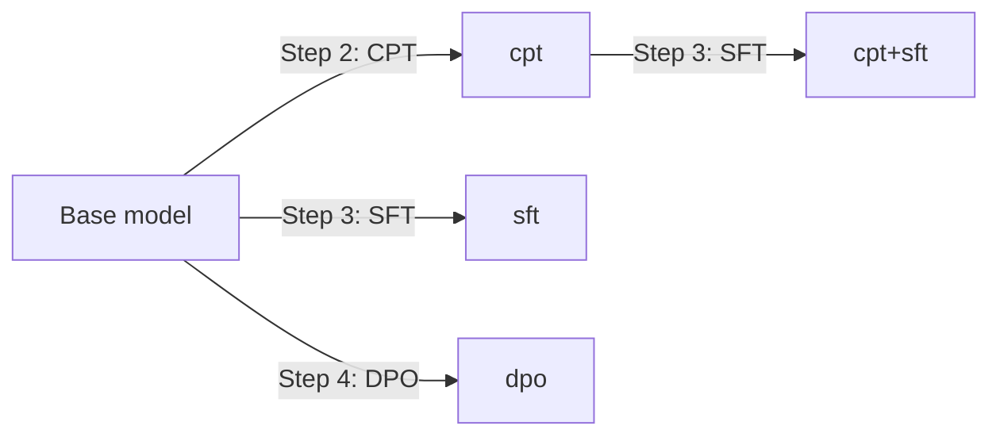

# Module 3: Customising LLMs (CPT, SFT, DPO)

**Time:** about 85 minutes, reading and lab together &nbsp;|&nbsp; **Track:** Free (T4), with a Pro bonus

## The situation

Module 2 set the baseline: on the 30 held-out Lumora questions, the small base model answered
about **10%** correctly, and most of that was lucky guessing. Lumora's leadership now wants an
assistant that does three things:

1. **Knows** Lumora's products and policies (knowledge)
2. **Answers questions** in a short, support-style format (a skill)
3. **Sounds like Lumora**: warm and friendly (behaviour)

Each goal needs a different training technique, and in this module you'll use all three on the
data you built in Module 1. You'll train **five models** and grade them all with Module 2's
calibrated judge, so you can see exactly what each technique adds.

### Why the model needs training

A language model learns one task: **predict the next token**. Given "The Eiffel Tower is in", it
assigns a probability to every token, and training nudges the weights so "Paris" gets more. After
trillions of tokens the weights hold a compressed memory of the training text, called **parametric
knowledge**. Three things follow:

1. **The model only knows what was in its training data.** No model has ever seen "the Vault 10
   has 10.2 kWh of usable capacity".
2. **Not knowing doesn't stop it answering.** It was trained to produce *plausible text*, not to
   say "I don't know", so it invents a capacity or a warranty term. That's a **hallucination**.
3. **To change what it knows, you change its weights**, or you put the information in front of it
   when the question is asked.

Module 2 showed the second option works: with the source document in the prompt (open-book), the
model scored near 100%. So why train at all?

| | In the prompt (RAG) | In the weights (fine-tuning) |
|---|---|---|
| **How** | Find relevant documents and paste them into the prompt | Train the model on the information |
| **Lumora result** | Open-book: about 100% (Module 2) | Closed-book: from about 10% to about 70% (this module) |
| **Update a fact** | Edit the document, instantly | Retrain |
| **Cost per question** | Higher: long prompts, plus a search system to run | Lower: short prompts |
| **Good at** | Fast-changing facts, citations, large document sets | Stable vocabulary, style, behaviour, answer format |
| **Weak at** | Behaviour and style | Fresh facts; risk of forgetting other skills |

!!! tip "In practice teams combine both"
    A common pattern: **fine-tune** for domain language, tone and answer format, and use **RAG**
    for facts that change. This module focuses on fine-tuning, and seeing how far closed-book
    knowledge can go also shows you what RAG buys you.

### Three goals, three techniques

| | Continued pretraining (CPT) | Supervised fine-tuning (SFT) | Direct preference optimisation (DPO) |
|---|---|---|---|
| **Goal** | Knowledge | Skills, answer format | Behaviour: style, tone, safety |
| **Data** | Raw domain text (manuals, policies) | Prompt and ideal response | Prompt, a *chosen* and a *rejected* response |
| **Learns from** | Every token | Response tokens only | The *difference* between chosen and rejected |
| **Lab setup** | Full fine-tuning, 6 epochs, LR 3e-5 | LoRA r=16, 6 epochs, LR 2e-4 | LoRA r=16, 3 epochs, LR 5e-5, beta 0.1 |
| **Typical failure** | Forgets general skills | Learns the format, invents the facts | Over-optimisation: fluent but empty |

In production the usual order is **CPT, then SFT, then DPO**: first know, then do, then behave.

### The plan

You'll train five models from the same small base model (Qwen2.5-0.5B on the free track), so each
technique's effect can be measured on its own and in combination:



Step 1 measures the base model, Steps 2-4 train, and Step 5 grades all five side by side.

<div class="lab-card" markdown>
**Open the lab now and work through it alongside this page**

[](https://colab.research.google.com/github/vinothss/add_llmknowledge/blob/main/notebooks/03_customization.ipynb)

The notebook uses the same step numbers as this page. Each step ends with a **▶ Lab** box.

| Exercise | Step | The check confirms |
|---|---|---|
| 1. CPT data and full fine-tuning config | 2 | end-of-text tokens, no loss masking, a learning rate suited to full fine-tuning; held-out fact perplexity drops at least 30% |
| 2. SFT data and LoRA | 3 | prompt/completion format, no contaminated pairs, LoRA on attention and MLP layers |
| 3. DPO preference data | 4 | no style instruction in the prompt, chosen more casual than rejected; reward accuracy at least 80%, style shift on unseen prompts |
| 4. Knowledge gain | 5 | CPT+SFT beats base by at least 15 points and beats SFT alone |
</div>

---

## Part A: Teach the facts

### Step 1: Measure the baseline

Every trained model is compared with the untouched base model on three measurements:

- **Answers** to the 30 held-out Lumora questions, graded by the judge in Step 5
- **Perplexity** on held-out Lumora fact sentences: how surprising the facts are to the model
- **MMLU** on a small slice: whether training damaged general knowledge

[Perplexity](https://en.wikipedia.org/wiki/Perplexity) is the exponential of the training loss,
$\text{PPL} = e^{\mathcal{L}}$. Roughly, it's *how many tokens the model is choosing between* at
each step: a perplexity of 20 means it's about as unsure as picking from 20 options. The fact
sentences are the evaluation questions with their reference answers, which are never trained on.

!!! example "▶ Lab: Step 1"
    Run the setup and baseline cells. Note the base model's perplexity and MMLU, and read a few of
    its answers.

The base model finds Lumora's facts very surprising. The first technique changes that.

---

### Step 2: Continued pretraining (CPT)

#### The objective

CPT uses exactly the objective the model was originally trained with. For a document of tokens
$x_1 \dots x_T$, the loss is the average negative log-probability of each token given everything
before it:

$$\mathcal{L}_\text{CPT} = -\frac{1}{T}\sum_{t=1}^{T} \log p_\theta(x_t \mid x_1, \dots, x_{t-1})$$

Every token is a training target. When the model reads "The Vault 10 weighs" and the next token is
"98", the update makes "98" more likely in that context. Repeat across every sentence for several
epochs and the facts become part of the model's memory. Gururangan et al. (2020) showed that
continuing pretraining on in-domain text consistently helps.

#### Memorising vs knowing: why paraphrases matter

A model that has seen "The Vault 10 weighs 98 kg" fifty times can *recite* it, but may still fail
"How heavy is the Vault 10?". Allen-Zhu & Li (2023) found that models reliably answer new questions
about a fact only when they saw it in **several phrasings** during training. One phrasing tends to
be stored as a string, not as a fact.

That's why the CPT corpus contains each of the 20 Lumora documents **plus 2-3 paraphrases** written
by an LLM (an FAQ version, a training-note version, a plain paragraph). A paraphrase was kept only
if every number in the original survived. Even so, a few contain small errors, such as "after
purchase" instead of "after delivery": **generated data needs the same checks as real data.**

#### Full fine-tuning, not LoRA, for CPT

The lab updates all of the model's roughly 494 million parameters (**full fine-tuning**). When this
lab was built, LoRA-based CPT (explained in Step 3) reached about 27% on the Lumora test, while
full CPT reached about 50%. That matches published findings: on knowledge-heavy training, LoRA
learns substantially less than full fine-tuning (Biderman et al., 2024). It also forgets less,
which is the other side of the same trade-off.

??? info "How it works: does full fine-tuning fit on a free T4?"
    Training with the Adam optimiser in fp32 needs about **16 bytes per parameter**:

    | Item | Bytes per parameter | 0.5B model |
    |---|---|---|
    | Weights (fp32) | 4 | 2 GB |
    | Gradients | 4 | 2 GB |
    | Adam first moment (m) | 4 | 2 GB |
    | Adam second moment (v) | 4 | 2 GB |
    | **Total, before activations** | **16** | **about 8 GB** |

    A T4 has 16 GB, so a 0.5B model fits, but activations need room too: over Qwen's 151,000-token
    vocabulary, the output layer alone needs 1-2 GB per batch of 4. So on GPUs the lab uses
    **8-bit Adam**, which shrinks the two moment buffers from 8 to 2 bytes per parameter. A 1.5B
    model (Pro track) would need about 24 GB, so it also uses **gradient checkpointing**
    (recomputing activations during the backward pass instead of storing them). A 7B model would
    need about 112 GB, which is why LoRA exists.

#### Catastrophic forgetting

Every update that makes Lumora's facts more likely also moves weights that encoded other things.
Push hard on a tiny corpus for many epochs and general ability degrades: **catastrophic
forgetting**. The lab watches for it with the MMLU slice. Production recipes limit it by mixing in
10-30% general text ("replay"), using a lower learning rate and fewer epochs, and stopping early if
a general benchmark drops.

#### Data format and pitfalls

One document per row, with the end-of-text token appended so the model learns where documents stop:

```json
{"text": "The Lumora Vault 10 is a wall-mounted home battery with 10.2 kWh of usable capacity. ... <|im_end|>"}
```

!!! warning "CPT pitfalls"
    - **Learning rate too high** for full fine-tuning (for example 2e-4, a LoRA rate): the loss
      spikes and general ability collapses. Use about 1e-5 to 5e-5.
    - **Too few epochs on a tiny corpus:** the facts never stick. The lab uses 6 epochs over 68 texts.
    - **Too many epochs:** the training loss approaches 0 and the model recites documents when asked
      anything.

!!! example "▶ Lab: Exercise 1, prepare the CPT data and training config"
    Add end-of-text tokens, choose a learning rate suited to full fine-tuning, and train. The check
    requires perplexity on the held-out facts to drop by at least 30%.

After CPT the model *knows* more, but it was trained to continue documents. Ask it a question and
it may carry on writing a manual page. That's the next problem.

---

## Part B: Teach it to answer

### Step 3: Supervised fine-tuning (SFT) with LoRA

#### What SFT is for

SFT shows the model many examples of **input and desired output**, so it learns a *behaviour*:
here, answering a support question in one short, accurate sentence. The training data is the Q&A
set from Module 1.

#### The objective, and loss masking

The loss has the same form as CPT, but only the **response tokens** count:

$$\mathcal{L}_\text{SFT} = -\frac{1}{|R|}\sum_{t \in R} \log p_\theta(x_t \mid x_{<t})$$

where $R$ is the set of positions in the assistant's reply. The prompt is still read as context,
but its tokens are **masked** (their labels set to -100) so they contribute nothing to the update:

| Tokens | `<system>` You are Lumora's support assistant... | `<user>` How long is the Vault warranty? | `<assistant>` 12 years. `<end>` |
|---|---|---|---|
| **In the loss?** | no (masked) | no (masked) | **yes** |

Without masking, part of the training effort goes into learning to *write questions and system
prompts*. In TRL you get masking by giving the data in **prompt/completion** format:

```json
{
  "prompt": [
    {"role": "system", "content": "You are Lumora Energy's support assistant. Answer in one short sentence."},
    {"role": "user", "content": "What does error code E-317 indicate?"}
  ],
  "completion": [
    {"role": "assistant", "content": "The Bridge has lost its internet connection for more than 72 hours."}
  ]
}
```

??? info "What is a chat template?"
    Instruct models are trained with special tokens that mark who is speaking. Qwen2.5, for
    example, wraps each turn in `<|im_start|>role ... <|im_end|>`. The **chat template** (stored
    with the tokenizer) turns a list of messages into that exact string. Always use the model's own
    template, in training and at inference: a mismatch is one of the most common reasons a
    fine-tuned model behaves strangely. Read more in the
    [Hugging Face chat templates guide](https://huggingface.co/docs/transformers/chat_templating).

#### Quality beats quantity

The LIMA study (Zhou et al., 2023) fine-tuned a 65B model on just **1,000 carefully chosen
examples** and got a strong assistant: evidence that SFT mainly teaches *format and behaviour*,
not new knowledge. You'll see the same in Step 5.

#### Decontamination: keep the test out of training

The Q&A pairs were generated from the same 20 documents the test questions were written from, so
some are near-copies of test questions:

| Training question (generated) | Test question (held out) |
|---|---|
| "What is the usable capacity of the Lumora Vault 10?" | "What is the usable capacity of the Lumora Vault 10?" |
| "How many Vault 15 units can be connected to a single Bridge inverter?" | "What is the maximum number of Vault 15 units on a single Bridge inverter?" |

Training on these would inflate the score without teaching anything, like giving students the
exam to study. The lab compares **content words** (what's left after removing "the", "what", "is"
and so on) using **[Jaccard similarity](https://en.wikipedia.org/wiki/Jaccard_index)**, the same
measure Module 1 used for deduplication:

$$J(A, B) = \frac{|A \cap B|}{|A \cup B|}$$

Any training question with $J \ge 0.6$ against a test question is dropped; with the shipped data
that removes 13 of 101 pairs. At internet scale the same problem is called **benchmark
contamination**.

#### LoRA: training a small fraction of the parameters

SFT here uses **LoRA** rather than full fine-tuning. Full fine-tuning updates every weight matrix
$W$. Hu et al. (2021) observed that the *change* needed during fine-tuning, $\Delta W$, can usually
be approximated by the product of two thin matrices. LoRA freezes $W$ and learns only those:

$$W' = W + \frac{\alpha}{r} B A, \qquad B \in \mathbb{R}^{d \times r},\; A \in \mathbb{R}^{r \times k},\; r \ll \min(d, k)$$

- $r$, the **rank**, controls capacity. The lab uses 16.
- $\alpha$ is a scaling factor; the lab uses $\alpha = 2r = 32$, a common default.
- $B$ starts at zero, so before training the model is exactly the original.
- After training, $BA$ can be **merged** into $W$, so there's no extra cost at inference.

??? info "How it works: how big is a LoRA adapter?"
    For a matrix of shape $d \times k$, the adapter adds $r(d + k)$ parameters. For Qwen2.5-0.5B
    (hidden size 896, MLP size 4864, 24 layers) with $r = 16$ on all seven projection matrices:

    | Matrix | Shape | LoRA params, r(d+k) |
    |---|---|---|
    | q_proj, o_proj | 896 x 896 | 28,672 each |
    | k_proj, v_proj | 896 x 128 | 16,384 each |
    | gate_proj, up_proj | 896 x 4864 | 92,160 each |
    | down_proj | 4864 x 896 | 92,160 |
    | **Per layer** | | **366,592** |
    | **24 layers** | | **about 8.8M, under 2% of 494M** |

    The optimiser only tracks those 8.8M parameters, so training needs a fraction of the memory.
    **QLoRA** (Dettmers et al., 2023) also stores the frozen model in 4-bit, which is how people
    fine-tune 7-8B models on one consumer GPU.

Transformer blocks have **attention** projections (q, k, v, o) and **MLP** projections (gate, up,
down). Facts seem to be stored largely in the MLP layers, and adapting only q and v, as the
original LoRA paper did, is noticeably weaker. The lab adapts **all seven**, the modern default.

| | LoRA | Full fine-tuning |
|---|---|---|
| Trainable parameters | about 1-2% | 100% |
| Memory | Low | About 16 bytes per parameter |
| Learns new **facts** | Weakly | Well |
| Learns **format and style** | Well | Well |
| Forgets general skills | Less | More |
| Storage | A few MB per adapter | A full copy per variant |
| **Lab use** | SFT, DPO | CPT |

Rule of thumb: **LoRA when you're changing *how* the model behaves; full fine-tuning when you're
changing *what* it knows.**

!!! example "▶ Lab: Exercise 2, prepare the SFT data and LoRA config"
    Convert the Q&A pairs to prompt/completion format, drop contaminated pairs, and target LoRA at
    all seven projections. Then train two models: SFT on the base model, and SFT on the CPT model.

The model now knows Lumora's facts and answers like support staff. The last goal is how it sounds.

---

## Part C: Teach it Lumora's voice

### Step 4: Give it Lumora's voice with DPO

#### Why preferences?

Some goals have no single correct answer. What's the *ideal* friendly reply to "My package hasn't
arrived"? There are thousands. But people find it easy to compare two replies and say which is
better. **Preference data** captures that: for each prompt, a **chosen** reply and a **rejected**
one.

#### From RLHF to DPO

The classic recipe, **[RLHF](https://en.wikipedia.org/wiki/Reinforcement_learning_from_human_feedback)**
(used for InstructGPT, Ouyang et al., 2022), has three stages: collect preference pairs, train a
separate **reward model** to score replies as people would, then optimise the LLM with
reinforcement learning to maximise that reward without drifting too far from the original. It works,
but it means training several models and is notoriously finicky. **DPO** (Rafailov et al., 2023)
showed the same goal can be reached **directly** from the preference pairs with a simple
classification-style loss: no reward model and no reinforcement learning.

#### The DPO loss, unpacked

For a prompt $x$ with chosen reply $y_w$ and rejected reply $y_l$:

$$\mathcal{L}_\text{DPO} = -\log \sigma\Big(\beta\big[\underbrace{\log\tfrac{\pi_\theta(y_w|x)}{\pi_\text{ref}(y_w|x)}}_{\text{chosen: how much more likely than before}} - \underbrace{\log\tfrac{\pi_\theta(y_l|x)}{\pi_\text{ref}(y_l|x)}}_{\text{rejected: how much more likely than before}}\big]\Big)$$

In words:

- $\pi_\theta$ is the model being trained; $\pi_\text{ref}$ is a **frozen copy** of where it started.
- Each log-ratio measures how much the model has changed its opinion of a reply since training began.
- The loss is low when the model has raised the chosen reply **more** than the rejected one.
- $\sigma$ is the sigmoid, so the loss works like logistic regression on "is chosen preferred?"
- $\beta$ sets how far the model is **allowed to drift** from the reference. A small $\beta$ (0.05)
  allows big changes; a large one (0.5) keeps it close. 0.1 is a common default.

With LoRA you don't need a second model in memory: the reference is the same network with the
adapter switched off.

#### Building the preference pairs, and the trap

The lab asks the 1.5B model to answer each everyday prompt twice: once told to be "warm, casual,
use contractions" (**chosen**) and once told to be "formal, impersonal, no contractions"
(**rejected**).

```json
{
  "prompt":   [{"role": "user", "content": "How do I reset my password?"}],
  "chosen":   [{"role": "assistant", "content": "Hey there! Just hit the \"Forgot Password\" link and follow the steps. If that doesn't work, support's happy to help!"}],
  "rejected": [{"role": "assistant", "content": "To reset your password, please navigate to the login page and select the \"Forgot Password\" option. Further assistance is available from customer support."}]
}
```

!!! danger "Don't leak the style instruction"
    The instruction used to *generate* the chosen reply ("reply casually...") must **not** be in
    the training prompt. If it is, the model learns "when told to be casual, be casual", which it
    could already do. At inference nobody adds that instruction, so the style never appears. The
    lab's starter code makes exactly this mistake on purpose, and the check catches it.

#### Reading the training logs

| Metric | Meaning | Healthy pattern |
|---|---|---|
| `rewards/chosen` | $\beta \times$ log-ratio for chosen replies | Stays near 0 or rises |
| `rewards/rejected` | The same for rejected replies | Falls (becomes negative) |
| `rewards/margins` | chosen minus rejected | Grows steadily |
| `rewards/accuracies` | Share of pairs where chosen beats rejected | Rises towards 0.8-1.0 |

!!! note "Chosen rewards can go *down* too"
    It's common for both rewards to fall, with rejected falling much faster. The margin grows, so
    the loss looks fine, but the model has made the chosen replies *less* likely in absolute terms.
    This "likelihood displacement" is a known DPO quirk, and one reason to always read actual
    replies, not just metrics.

#### Over-optimisation

Push too hard and DPO games its own signal. At a 4x higher learning rate (2e-4) the lab's model
reached even better reward metrics, and its replies collapsed into empty cheerfulness:

> "Hey there! Here's some fun ideas!"

It found that exclamation marks and contractions were what separated chosen from rejected, and
maximised *those* at the expense of helpfulness. **Any proxy metric can be gamed.** Defences: a
sensible $\beta$ and learning rate, fewer epochs, and evaluating helpfulness alongside style. You'll
meet this again in Module 5.

??? info "Beyond DPO: the alignment family"
    | Method | Idea |
    |---|---|
    | **RLHF / PPO** | Reward model plus reinforcement learning. Most flexible, most complex |
    | **DPO** | Direct optimisation on preference pairs (this lab) |
    | **IPO** | Adds regularisation against overfitting to preferences |
    | **KTO** | Needs only a "good" or "bad" label per reply, not pairs |
    | **ORPO** | Combines SFT and preference optimisation in one stage, no reference model |
    | **SimPO** | Reference-free, length-normalised reward |

    NeMo-RL and TRL implement several of these. The data and evaluation discipline is the same.

!!! example "▶ Lab: Exercise 3, build the preference pairs"
    Write `to_preference` without leaking the style instruction, train with DPO, and watch the
    reward metrics. The check requires reward accuracy of at least 80% and a style shift on prompts
    the model never saw. Optionally, re-run with learning rate 2e-4 and read what happens.

You now have five models. Time to find out what each technique really did.

---

## Part D: Compare the results

### Step 5: Grade everything with Module 2's judge

The notebook recalibrates Module 2's judge (same method, same data) and grades all five models'
answers. Results from our reference run (yours will vary by a few points):

| Model | Lumora accuracy | Fact perplexity | MMLU | What happened |
|---|---|---|---|---|
| base | 10% | 86 | 68% | Doesn't know Lumora |
| sft | 20% | 50 | 70% | Perfect one-sentence format, **invented facts** |
| cpt | 50% | 15 | 70% | Knows the facts, but answers can ramble |
| **cpt+sft** | **70%** | **11** | 70% | Knowledge **plus** the answer format |
| dpo | 3% | 86 | 68% | Casual tone, no Lumora knowledge: it chats instead of stating facts |

Three lessons:

1. **SFT alone doesn't add knowledge.** About 90 Q&A pairs can't teach 20 documents' worth of
   facts. SFT teaches *how* to answer, and the model fills that shape with whatever it knows. With
   CPT first, it knows the right things.
2. **Perplexity on held-out facts fell from 86 to 11**, even though the model never saw those
   exact sentences: the knowledge generalised.
3. **MMLU didn't move** on the 50-question slice, so there's no measurable forgetting at this
   scale. Longer training or a bigger corpus can cost general knowledge, so always check.

The DPO model also shows why techniques stack: it learned the voice (its casualness score on unseen
prompts rose from 0.17 to 0.77) but, trained on the base model, it knows nothing about Lumora.

!!! example "▶ Lab: Exercise 4, grade the five models"
    Grade every model with the recalibrated judge and compare with the table above. The check
    requires CPT+SFT to beat the base model by at least 15 points and to beat SFT alone.

#### The hyperparameters, and why

| | CPT | SFT | DPO |
|---|---|---|---|
| Method | Full fine-tuning | LoRA r=16, alpha=32 | LoRA r=16, alpha=32 |
| Learning rate | 3e-5 | 2e-4 | 5e-5 |
| Epochs | 6 | 6 | 3 |
| Batch size | 8 | 8 | 4 x 2 accumulation |
| Schedule | Cosine, 2 warm-up steps | Cosine | Cosine |
| Why | A small learning rate protects general ability; several epochs because the corpus is tiny | LoRA tolerates a higher rate; repeated passes fix the format | A gentle rate avoids over-optimisation; beta 0.1 is the standard anchor |

Learning rates differ by about 10x between full fine-tuning and LoRA because LoRA's update starts at
zero and is scaled by $\alpha / r$. Copying a LoRA learning rate into a full fine-tune is one of the
most common ways to wreck a model.

### Module result

The notebook logs every model to MLflow and saves `results.json`. You now have an assistant that
knows Lumora and answers like support. Module 4 asks the next question: how to make a model like
this small and fast enough to deploy.

<div class="lab-complete" data-id="m03"></div>

---

## Wrap-up

### Key takeaways

- **CPT adds knowledge, SFT adds skills, DPO shapes behaviour.** Use the right tool for the goal,
  and stack them: CPT, then SFT, then DPO.
- **LoRA changes behaviour cheaply; full fine-tuning changes knowledge.**
- **Keep the test out of training,** or your scores mean nothing.
- **Read the outputs, not just the metrics.** Over-optimised DPO and likelihood displacement both
  look fine on the reward curves.
- **Check general ability after every stage.**

### At production scale: NVIDIA NeMo

| Lab (TRL + PEFT) | NeMo Framework / NeMo-RL |
|---|---|
| `SFTTrainer` on plain text (CPT) | NeMo 2.0 pretraining recipe resumed from a checkpoint |
| `SFTTrainer` prompt/completion + LoRA | NeMo `finetune` recipe with `peft="lora"` |
| `DPOTrainer` (`beta`, reference model) | NeMo-RL DPO with a reference-policy penalty |
| `merge_and_unload()` | NeMo LoRA merge, then export for deployment |

The concepts, data formats and failure modes are the same. NeMo adds multi-GPU and multi-node
training for models far larger than a T4 can hold.

### Common pitfalls

- [ ] Test questions, or near-copies, in the training data: **decontaminate**
- [ ] Different chat templates in training and inference: **always use the tokenizer's template**
- [ ] SFT loss computed on prompts: **use prompt/completion format**
- [ ] A LoRA learning rate used for full fine-tuning: **drop it about 10x**
- [ ] Style instruction left in DPO prompts: **remove it**
- [ ] Only metrics checked, no replies read: **always read generations**
- [ ] General ability not re-checked: **run MMLU, or similar, after every stage**

### Knowledge check

<script type="application/json" class="quiz" data-id="m03">
[
  {"q": "Your product specs change every month. What's the best way to keep an assistant accurate on them?",
   "options": ["Continued pretraining every month", "Retrieval (RAG) for the specs, with fine-tuning for tone and format", "DPO on the new specs", "A bigger base model"],
   "answer": 1, "why": "Fast-changing facts belong in retrieval; fine-tuning is best for stable knowledge, format and behaviour."},
  {"q": "After SFT alone, the model answers in the perfect support format but gets most facts wrong. Why?",
   "options": ["The learning rate was too low", "SFT teaches format and skills; without the knowledge, the model fills the format with invented facts", "LoRA cannot be used for SFT", "The judge is broken"],
   "answer": 1, "why": "In the lab, SFT alone reached about 20% against about 70% for CPT followed by SFT."},
  {"q": "Why does the lab use full fine-tuning rather than LoRA for continued pretraining?",
   "options": ["LoRA can't train on plain text", "Low-rank updates absorb new facts poorly; full fine-tuning reached about 50% vs about 27% for LoRA", "Full fine-tuning uses less memory", "TRL requires it"],
   "answer": 1, "why": "LoRA learns less (and forgets less). Adding knowledge needs more capacity."},
  {"q": "How many trainable parameters does a rank-16 LoRA add to one 896 x 4864 matrix?",
   "options": ["16", "about 92,000", "about 4.4 million", "896 x 4864"],
   "answer": 1, "why": "r(d+k) = 16 x (896 + 4864) = 92,160."},
  {"q": "Why use the prompt/completion format for SFT?",
   "options": ["It makes training faster", "Loss is computed only on the answer, so the model learns to answer rather than to write questions", "TRL requires it for LoRA", "It removes the need for a chat template"],
   "answer": 1, "why": "Masking the prompt focuses all learning on the response."},
  {"q": "A DPO training prompt reads: 'Reply casually. How do I reset my password?' What's wrong?",
   "options": ["Nothing", "The style instruction leaks into the prompt, so the model learns to obey it rather than adopt the style unprompted", "Prompts must be in the system role", "DPO prompts cannot be questions"],
   "answer": 1, "why": "At inference nobody adds 'reply casually', so the style must be learned from the preference signal alone."},
  {"q": "In DPO, what does increasing beta from 0.1 to 0.5 do?",
   "options": ["Lets the model drift further from the reference", "Keeps the model closer to the reference model", "Doubles the learning rate", "Removes the need for rejected replies"],
   "answer": 1, "why": "beta anchors the model: a larger beta pulls it more strongly towards the reference."},
  {"q": "DPO reward accuracy hits 100% but replies become 'Hey there! Here's some fun ideas!' What happened?",
   "options": ["Catastrophic forgetting of style", "Over-optimisation: the model maximised surface style signals and dropped helpfulness", "A tokenizer bug", "The reference model was too strong"],
   "answer": 1, "why": "Metrics can be gamed. Read generations and tune beta and the learning rate."}
]
</script>

### Glossary

| Term | Meaning |
|---|---|
| **Parametric knowledge** | Information stored in the model's weights |
| [**Perplexity**](https://en.wikipedia.org/wiki/Perplexity) | $e^{\text{loss}}$; roughly how many tokens the model is choosing between |
| **Epoch** | One full pass over the training data |
| **Loss masking** | Excluding tokens, such as the prompt, from the loss by setting their label to -100 |
| [**Chat template**](https://huggingface.co/docs/transformers/chat_templating) | The recipe that turns a list of messages into the special-token string a model expects |
| [**LoRA rank (r)**](https://huggingface.co/docs/peft/main/en/conceptual_guides/lora) | The width of the low-rank update; higher means more capacity |
| **Merge** | Folding a LoRA update into the base weights for deployment |
| [**Reference model**](https://huggingface.co/docs/trl/dpo_trainer) | The frozen starting copy that DPO measures change against |
| [**beta**](https://huggingface.co/docs/trl/dpo_trainer) | How far DPO lets the model drift from the reference |
| [**Catastrophic forgetting**](https://en.wikipedia.org/wiki/Catastrophic_interference) | Loss of general ability after narrow fine-tuning |
| **Contamination** | Test items, or near-copies, present in training data |

### Further reading

**Papers**

- Hu et al. (2021), [*LoRA: Low-Rank Adaptation of Large Language Models*](https://arxiv.org/abs/2106.09685)
- Gururangan et al. (2020), [*Don't Stop Pretraining: Adapt Language Models to Domains and Tasks*](https://arxiv.org/abs/2004.10964)
- Allen-Zhu & Li (2023), [*Physics of Language Models: Part 3.1, Knowledge Storage and Extraction*](https://arxiv.org/abs/2309.14316)
- Zhou et al. (2023), [*LIMA: Less Is More for Alignment*](https://arxiv.org/abs/2305.11206)
- Ouyang et al. (2022), [*Training language models to follow instructions with human feedback*](https://arxiv.org/abs/2203.02155)
- Rafailov et al. (2023), [*Direct Preference Optimization: Your Language Model is Secretly a Reward Model*](https://arxiv.org/abs/2305.18290)
- Dettmers et al. (2023), [*QLoRA: Efficient Finetuning of Quantized LLMs*](https://arxiv.org/abs/2305.14314)
- Biderman et al. (2024), [*LoRA Learns Less and Forgets Less*](https://arxiv.org/abs/2405.09673)

**Concepts and tools**

- [Retrieval-augmented generation (Wikipedia)](https://en.wikipedia.org/wiki/Retrieval-augmented_generation)
- [Hallucination in AI (Wikipedia)](https://en.wikipedia.org/wiki/Hallucination_(artificial_intelligence))
- [Cross-entropy (Wikipedia)](https://en.wikipedia.org/wiki/Cross-entropy)
- [Perplexity (Wikipedia)](https://en.wikipedia.org/wiki/Perplexity)
- [Low-rank approximation (Wikipedia)](https://en.wikipedia.org/wiki/Low-rank_approximation)
- [Catastrophic interference / forgetting (Wikipedia)](https://en.wikipedia.org/wiki/Catastrophic_interference)
- [Reinforcement learning from human feedback (Wikipedia)](https://en.wikipedia.org/wiki/Reinforcement_learning_from_human_feedback)
- [Sigmoid function (Wikipedia)](https://en.wikipedia.org/wiki/Sigmoid_function)
- [Kingma & Ba (2014), *Adam: A Method for Stochastic Optimization*](https://arxiv.org/abs/1412.6980)
- [Hugging Face: chat templates](https://huggingface.co/docs/transformers/chat_templating)
- [Hugging Face PEFT: LoRA conceptual guide](https://huggingface.co/docs/peft/main/en/conceptual_guides/lora)
- [TRL: SFTTrainer documentation](https://huggingface.co/docs/trl/sft_trainer)
- [TRL: DPOTrainer documentation](https://huggingface.co/docs/trl/dpo_trainer)
