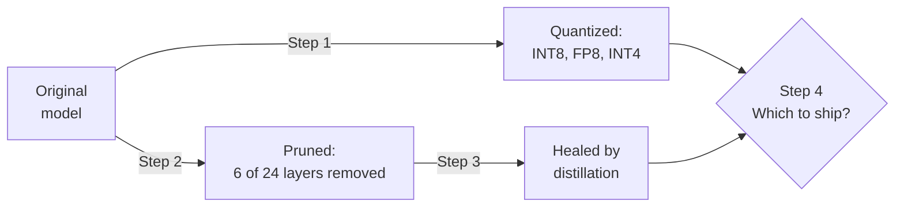

# Module 4: Optimising LLMs for deployment

**Time:** about 75 minutes, reading and lab together &nbsp;|&nbsp; **Track:** Free (T4), with a Pro bonus

## The situation

Module 3 produced an assistant that knows Lumora and answers like support staff. Now Lumora's
finance team has a question: **what will it cost to run?** Every customer question means paying for
every token the model generates, for every customer, for as long as the assistant is live.

They want it **smaller and faster**, without it getting noticeably worse. In this module you'll try
the three main compression techniques and measure exactly what each one costs:

1. **Quantization:** store each weight in fewer bits
2. **Pruning:** delete whole layers
3. **Distillation:** let the original model repair the pruned one

Then you'll put the results side by side and decide which version Lumora should ship.

To keep the measurements clean, the lab compresses the base student model (Qwen2.5-0.5B on the free
track) and measures **perplexity** on held-out Wikipedia text (general language ability; lower is
better), an **MMLU** slice (knowledge), **speed** and **size**. The same techniques apply unchanged
to the model you trained in Module 3.

### Why optimise?

| Goal | Why it matters |
|---|---|
| **Memory** | Fit on a cheaper GPU, or serve more customers per GPU |
| **Latency** | Time to first token and time per token decide how responsive it feels |
| **Throughput** | Tokens per second across all customers decides the cost per request |
| **Energy and cost** | Fewer GPU-hours for the same traffic |

The constraint: **accuracy must stay acceptable on the tasks you care about.** Every technique here
trades some accuracy for efficiency, and the job is to measure that trade-off.

### Where inference time goes

Generating text has two phases:

1. **Prefill:** the whole prompt is processed at once. This keeps the GPU's maths units busy
   (**compute-bound**).
2. **Decode:** tokens are generated one at a time. For each new token the GPU must read **every
   weight** from memory, but does relatively little maths with it (**memory-bandwidth-bound**).

For a 7B model in FP16 (14 GB), each new token means reading 14 GB of weights. A GPU with about
1 TB/s of memory bandwidth can therefore manage at most about 70 tokens per second for one user,
however fast its maths units are. **Halve the bytes per weight and you roughly double that limit.**
That's why quantization is the first optimisation almost everyone applies.

??? info "The KV cache: the other big memory user"
    During generation the model stores each past token's attention **keys and values** so it
    doesn't recompute them. That cache grows with conversation length and the number of
    conversations served at once:

    $$\text{KV bytes} = 2 \times \text{layers} \times \text{kv\_heads} \times \text{head\_dim} \times \text{tokens} \times \text{batch} \times \text{bytes per value}$$

    For Qwen2.5-0.5B (24 layers, 2 KV heads of dimension 64) in FP16 that's about 12 KB per token,
    so 32 conversations of 4,000 tokens each need about 1.5 GB. For large models with long contexts
    the KV cache can be bigger than the weights. It can be quantized too (for example an FP8 KV
    cache), and grouped-query attention (GQA, used by Qwen and Llama) exists to shrink it.

### The plan

**Open the lab now and work through it alongside this page**

The notebook uses the same step numbers as this page. Each step ends with a **▶ Lab** box.

| Exercise | Step | The check confirms |
|---|---|---|
| 1. Absmax quantizer (per-row and per-group) | 1 | integer range, round-trip error, outlier protection with groups; INT8 within 5% of the original's perplexity, INT4 in groups better than per-row |
| 2. Layer importance and depth pruning | 2 | one score per layer, first and last layers kept, least important dropped, pruned model still runs |
| 3. Distillation loss and healing | 3 | the loss is 0 for identical models, temperature scaling correct; distillation recovers at least 30% of the pruning damage |
| Pro bonus | 4 | Qwen2.5-1.5B student; how to run real FP8 with TensorRT Model Optimizer and TensorRT-LLM |

---

## Part A: Fewer bits per weight

### Step 1: Quantize the model

#### Number formats

The model's weights are stored as numbers, and the format decides how many bytes each one takes.
A floating-point number has a **sign**, an **exponent** (its range) and a **mantissa** (its
precision):

| Format | Bits (sign / exponent / mantissa) | Largest value | Bytes | A 7B model's weights |
|---|---|---|---|---|
| FP32 | 1 / 8 / 23 | about 3.4e38 | 4 | 28 GB |
| FP16 | 1 / 5 / 10 | 65,504 | 2 | 14 GB |
| BF16 | 1 / 8 / 7 | about 3.4e38 | 2 | 14 GB |
| FP8 E4M3 | 1 / 4 / 3 | 448 | 1 | 7 GB |
| FP8 E5M2 | 1 / 5 / 2 | 57,344 | 1 | 7 GB |
| INT8 | 8-bit integer + scale | 127 x scale | 1 | 7 GB |
| INT4 / NF4 | 4-bit integer + scale | 7 x scale | 0.5 | 3.5 GB |

- **BF16** keeps FP32's range with less precision. It's the standard training format on modern
  GPUs because it rarely overflows. The T4 doesn't support it, which is why the labs use FP16 there.
- **FP16** has more precision but a small range: values above 65,504 overflow.
- **FP8** comes in two kinds: E4M3 (more precision, usually for weights and activations) and E5M2
  (more range, often for gradients). It runs natively on NVIDIA **Hopper** (H100) and **Ada** (L4)
  GPUs, but not on the T4 or A100.
- **INT8 and INT4** store whole numbers plus a floating-point **scale** that maps them back to real
  values.

#### The core operation

Quantization maps precise values onto a small set of levels. The simplest scheme, **symmetric
absmax INT8**, works on a group of weights $w$:

$$s = \frac{\max |w|}{127}, \qquad q = \text{round}\!\left(\frac{w}{s}\right) \in [-127, 127], \qquad \hat{w} = s \cdot q$$

Each weight is stored as one byte $q$, and the group shares one scale $s$. The rebuilt value
$\hat{w}$ is close to $w$; the difference is the **quantization error**.

!!! example "Quantizing four weights"
    $w = [0.12, -0.50, 0.33, 0.04]$, so $\max|w| = 0.50$ and $s = 0.50/127 \approx 0.003937$.
    Then $q = [30, -127, 84, 10]$ and $\hat{w} = [0.118, -0.500, 0.331, 0.039]$.
    The error is under 0.002 per weight, in a quarter of FP32's memory.

#### Who shares a scale?

| Granularity | One scale per | Accuracy | Extra storage |
|---|---|---|---|
| Per-tensor | Whole matrix | Lowest: one outlier ruins everyone's precision | Negligible |
| Per-row (per-channel) | Output row | Good | Small |
| Per-group | Block of, say, 128 weights | Best (standard for INT4) | A few percent |

With 8 bits there are 255 levels, so even one scale per row works well. With 4 bits there are only
15, and one large weight in a row squeezes all the others onto a few levels. Smaller groups
contain that damage.

??? info "Beyond the lab: the outlier problem in larger models"
    LLM **activations** (the values flowing between layers, not the weights) contain rare but huge
    values in a few channels. Dettmers et al. (2022, *LLM.int8()*) showed these appear in models of
    a few billion parameters and up, and that naive INT8 quantization of activations then collapses
    accuracy: one outlier stretches the scale and most other values round to zero. Fixes:

    - **Mixed precision:** keep the outlier channels in FP16 (LLM.int8()).
    - **SmoothQuant:** move the difficulty from activations into weights, which quantize more easily.
    - **Weight-only quantization:** quantize the weights and keep activations in FP16
      (**W4A16** or **W8A16**). Great for memory-bound decoding.
    - **FP8:** its exponent handles a wide range far better than INT8, so quantizing both weights
      and activations to FP8 (**W8A8-FP8**) is often close to lossless.

??? info "Beyond the lab: post-training quantization vs quantization-aware training"
    | | Post-training quantization (PTQ) | Quantization-aware training (QAT) |
    |---|---|---|
    | How | Quantize a finished model, using a small **calibration set** to measure value ranges | Simulate quantization during training so the model adapts |
    | Cost | Minutes | A training run |
    | Accuracy | Excellent at 8-bit; can degrade at 4-bit | Best at low bit-widths |
    | Methods | absmax, **GPTQ** (corrects rounding error as it goes), **AWQ** (protects important weights) | Fake quantization during training |

    The calibration set should look like real traffic: a few hundred of the prompts the model will
    actually see. Calibrating on random web text and deploying on Lumora support questions is a
    classic mistake.

!!! example "▶ Lab: Exercise 1, write `quantize` and `dequantize`"
    Implement absmax quantization per row and per group, look at one real weight matrix, then
    quantize the whole model to INT8, simulated FP8, and INT4 (per row and in groups of 128).

Results from our reference run (perplexity: lower is better; MMLU on 50 questions, chance is 25%):

| Variant | Perplexity | MMLU |
|---|---|---|
| Original (FP16) | 24.1 | 68% |
| INT8 | 24.0 | 68% |
| FP8 (simulated) | 24.2 | 66% |
| INT4, one scale per row | 60.9 | 28% |
| INT4, one scale per 128 weights | 35.5 | 50% |

8 bits is essentially free. 4 bits is not, and grouping makes the difference between "damaged"
and "useless". Quantization makes every weight smaller; the next technique removes weights
altogether.

---

## Part B: Fewer layers

### Step 2: Prune the layers that matter least

| Type of pruning | Removes | Real speed-up? |
|---|---|---|
| **Unstructured** | Individual weights (set to zero) | Rarely: the hardware still multiplies the zeros |
| **Semi-structured (2:4)** | 2 of every 4 consecutive weights | Yes, on NVIDIA Ampere GPUs and later |
| **Structured: width** | Attention heads, neurons, channels | Yes: the matrices really shrink |
| **Structured: depth** | Whole transformer layers | Yes: fewer steps per token |

The lab uses **depth pruning**: removing whole layers.

#### Which layers can go?

Each transformer layer adds a correction to the model's running hidden state. If a layer's output
is almost the same as its input, it isn't contributing much. A simple importance score is the
**[cosine similarity](https://en.wikipedia.org/wiki/Cosine_similarity)** between a layer's input
and output, averaged over sample text:

$$\text{importance}_\ell = 1 - \cos\big(h_\ell^{\text{in}}, h_\ell^{\text{out}}\big)$$

Layers with low importance are candidates for removal. Studies (Men et al., 2024, *ShortGPT*;
Gromov et al., 2024) found that a large share of the deeper layers can be removed with modest
damage, especially if the model is retrained briefly afterwards. The first and last layers are
almost always critical.

!!! example "▶ Lab: Exercise 2, write `layer_importance` and `prune_layers`"
    Score every layer, plot the scores, and remove the 6 least important of the 24, always keeping
    the first and last. Check that the pruned model still runs.

Removing a quarter of the layers hurts a lot: in our reference run, perplexity rose from 24.1 to
76.4 and MMLU fell to chance (24%). Pruning almost always needs a repair step, and that's next.

---

### Step 3: Heal the pruned model with distillation

#### The idea

A large **teacher** model's output carries more information than the right answer alone. For "The
Vault warranty lasts ___", a teacher might put 70% on "12", 15% on "twelve" and a little on other
numbers. That full distribution, the **soft targets**, tells the student which mistakes are "nearly
right". Hinton et al. (2015) called this the teacher's *dark knowledge*.

To heal a pruned model, the teacher is the **original, unpruned model** and the student is the
pruned one. NVIDIA's **Minitron** work (2024) pruned Nemotron and Llama models this way, then
distilled from the original, reaching strong smaller models with a small fraction of the training
needed to build them from scratch.

#### The loss

Soften both distributions with a **temperature** $T > 1$ (dividing the logits $z$ by $T$ before the
softmax) and make the student match the teacher using
[KL divergence](https://en.wikipedia.org/wiki/Kullback%E2%80%93Leibler_divergence), usually mixed
with the normal loss on real data:

$$\mathcal{L} = \alpha\, T^2\, \mathrm{KL}\!\left(\mathrm{softmax}(z_t / T)\,\big\|\,\mathrm{softmax}(z_s / T)\right) + (1 - \alpha)\,\mathcal{L}_{\text{CE}}$$

- $z_t$, $z_s$: teacher and student logits
- $T$: higher values spread the probability out, revealing more of the teacher's ranking (2-4 is common)
- $T^2$: keeps the size of updates comparable as $T$ changes
- $\alpha$: the balance between copying the teacher and fitting the data

| Kind of distillation | Student learns from | Notes |
|---|---|---|
| **Logit distillation** | The teacher's full token probabilities | Needs a shared tokenizer; strongest signal (this lab) |
| **Sequence-level** | Text the teacher wrote | Works across tokenizers; Module 1's Q&A generation was a form of this |
| **Feature distillation** | The teacher's hidden states | Used when the architectures line up |

!!! example "▶ Lab: Exercise 3, write `distill_loss` and heal the pruned model"
    Implement the loss, check it's 0 when teacher and student are identical, then distil for 200
    steps. The check requires recovering at least 30% of the perplexity damage.

In our reference run, distillation took perplexity from 76.4 back to 43.1, **recovering 64% of the
damage in about two minutes**. But MMLU stayed at chance level (12%). Fluency comes back quickly;
knowledge stored in the deleted layers needs a far bigger budget (Minitron used billions of tokens;
the lab uses about 100,000). The notebook suggests trying a gentler prune to see the difference.

---

## Part C: Decide what to ship

### Step 4: Choose a point on the trade-off curve

Never report "4x smaller" without "and lost X points on Y". For each version, measure:

| Axis | Metric |
|---|---|
| Size | GB on disk; GPU memory at your expected load |
| Latency | Time to first token, time per token |
| Throughput | Tokens per second with realistic traffic |
| General accuracy | An MMLU slice (from Module 2) |
| **Domain accuracy** | **The Lumora test with the calibrated judge** (from Module 2) |

Then plot accuracy against cost. A version that is both bigger *and* worse than another is
**dominated** and can be discarded. The rest form the **[Pareto frontier](https://en.wikipedia.org/wiki/Pareto_front)**,
and you pick the point that fits your budget.

All the results from our reference run, together:

| Version | Perplexity | MMLU | Verdict |
|---|---|---|---|
| Original (FP16) | 24.1 | 68% | Baseline |
| INT8 | 24.0 | 68% | **Ship it: half the weight size, no measurable loss** |
| FP8 (simulated) | 24.2 | 66% | Equally good, on GPUs that support FP8 |
| INT4, per row | 60.9 | 28% | Dominated by INT4 in groups |
| INT4, groups of 128 | 35.5 | 50% | About 4x smaller weights, real accuracy cost |
| 6 layers pruned | 76.4 | 24% | Too damaged |
| ...then distilled | 43.1 | 12% | Fluent again, knowledge not restored |

Rules of thumb, which you should always confirm on your own model:

- **FP8 or INT8** weight quantization: usually within about a point on most benchmarks.
- **INT4** weight-only (GPTQ, AWQ): usually small losses; larger on maths, code and small models.
- **Depth pruning without healing:** large losses. **With a short distillation:** fluency recovers
  quickly, knowledge much less.
- **Small models degrade more** under every technique: there's less redundancy to remove. Pruning
  pays off on large models with a big distillation budget, where removing layers cuts latency on
  every token.

!!! example "▶ Lab: Step 4, compare the versions"
    Plot size against perplexity, identify the dominated versions, and decide what you'd ship.
    **Pro bonus:** on an L4 runtime, the notebook shows how to run *real* FP8 with TensorRT Model
    Optimizer and TensorRT-LLM.

For Lumora, the answer is clear: **quantize to INT8 (or FP8) first**, and always confirm on the
Lumora test before shipping.

### Module result

The notebook logs every version to MLflow and saves `results.json`. You can now teach a model
Lumora's facts and make it cheap to run. One requirement is left before customers can use it,
and it's the one that matters most: it must be safe. That's the Module 5 assessment.

---

## Wrap-up

### Key takeaways

- **Decoding is limited by memory speed,** so fewer bytes per weight means faster generation.
- **8-bit is close to free; 4-bit needs small groups,** and still costs some accuracy.
- **Pruning removes real compute, but hurts;** distillation from the original model repairs fluency
  quickly and knowledge slowly.
- **Measure every version on size, speed and accuracy,** and discard the dominated ones.

### At production scale: TensorRT-LLM

**[TensorRT-LLM](https://github.com/NVIDIA/TensorRT-LLM)** is NVIDIA's open-source library for fast
LLM inference. It compiles a model into an optimised engine with fused operations, continuous
batching, a paged KV cache, and FP8, INT8 and INT4 support. **NVIDIA TensorRT Model Optimizer
(ModelOpt)** performs the quantization (including FP8 with calibration), pruning and distillation
that produce the model you then build into an engine. NeMo models export into this path for
serving, for example behind NVIDIA NIM or Triton.

### Common pitfalls

- [ ] Reporting a smaller size without the accuracy cost
- [ ] One scale per row for 4-bit weights, so a single outlier ruins the row
- [ ] Calibrating on random text instead of real traffic
- [ ] Expecting zeroed weights (unstructured pruning) to speed things up on normal hardware
- [ ] Removing the first or last layer
- [ ] Judging a healed model by perplexity alone: fluency recovers long before knowledge
- [ ] Skipping the domain test before shipping

### Knowledge check

### Glossary

| Term | Meaning |
|---|---|
| **Prefill / decode** | Processing the prompt all at once / generating tokens one by one |
| **Memory-bandwidth-bound** | Speed limited by how fast weights can be read, not by maths |
| **KV cache** | Stored attention keys and values for past tokens |
| [**Scale**](https://en.wikipedia.org/wiki/Quantization_(signal_processing)) | The floating-point factor that maps quantized integers back to real values |
| **Calibration set** | Representative data used to measure value ranges for quantization |
| **W4A16** | 4-bit weights, 16-bit activations (weight-only quantization) |
| **Outlier features** | Rare, very large activation values that break naive quantization |
| [**Structured pruning**](https://en.wikipedia.org/wiki/Pruning_(artificial_neural_network)) | Removing whole components (heads, neurons, layers) so the matrices shrink |
| [**Soft targets**](https://en.wikipedia.org/wiki/Knowledge_distillation) | The teacher's full probability distribution, used in distillation |
| [**Temperature**](https://en.wikipedia.org/wiki/Softmax_function) | A divisor applied to logits that flattens a distribution |
| [**Pareto frontier**](https://en.wikipedia.org/wiki/Pareto_front) | The options that no other option beats on every axis |

### Further reading

**Papers**

- Dettmers et al. (2022), [*LLM.int8(): 8-bit Matrix Multiplication for Transformers at Scale*](https://arxiv.org/abs/2208.07339)
- Frantar et al. (2023), [*GPTQ: Accurate Post-Training Quantization for Generative Pre-trained Transformers*](https://arxiv.org/abs/2210.17323)
- Lin et al. (2024), [*AWQ: Activation-aware Weight Quantization for LLM Compression and Acceleration*](https://arxiv.org/abs/2306.00978)
- Xiao et al. (2023), [*SmoothQuant: Accurate and Efficient Post-Training Quantization for LLMs*](https://arxiv.org/abs/2211.10438)
- Micikevicius et al. (2022), [*FP8 Formats for Deep Learning*](https://arxiv.org/abs/2209.05433)
- Hinton, Vinyals & Dean (2015), [*Distilling the Knowledge in a Neural Network*](https://arxiv.org/abs/1503.02531)
- Men et al. (2024), [*ShortGPT: Layers in Large Language Models are More Redundant Than You Expect*](https://arxiv.org/abs/2403.03853)
- Gromov et al. (2024), [*The Unreasonable Ineffectiveness of the Deeper Layers*](https://arxiv.org/abs/2403.17887)
- Muralidharan et al. (2024), [*Compact Language Models via Pruning and Knowledge Distillation*](https://arxiv.org/abs/2407.14679) (Minitron)

**Concepts and tools**

- [Half-precision floating point, FP16 (Wikipedia)](https://en.wikipedia.org/wiki/Half-precision_floating-point_format)
- [bfloat16 floating-point format (Wikipedia)](https://en.wikipedia.org/wiki/Bfloat16_floating-point_format)
- [Quantization in signal processing (Wikipedia)](https://en.wikipedia.org/wiki/Quantization_(signal_processing))
- [Cosine similarity (Wikipedia)](https://en.wikipedia.org/wiki/Cosine_similarity)
- [Pruning artificial neural networks (Wikipedia)](https://en.wikipedia.org/wiki/Pruning_(artificial_neural_network))
- [Knowledge distillation (Wikipedia)](https://en.wikipedia.org/wiki/Knowledge_distillation)
- [Kullback-Leibler divergence (Wikipedia)](https://en.wikipedia.org/wiki/Kullback%E2%80%93Leibler_divergence)
- [Softmax function and temperature (Wikipedia)](https://en.wikipedia.org/wiki/Softmax_function)
- [Pareto front (Wikipedia)](https://en.wikipedia.org/wiki/Pareto_front)
- [bitsandbytes documentation (Hugging Face)](https://huggingface.co/docs/bitsandbytes/main/en/index)
- [NVIDIA TensorRT-LLM (GitHub)](https://github.com/NVIDIA/TensorRT-LLM)
- [NVIDIA TensorRT Model Optimizer (GitHub)](https://github.com/NVIDIA/TensorRT-Model-Optimizer)
